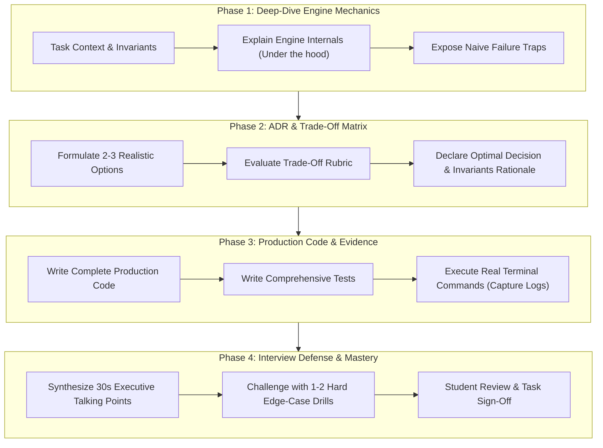
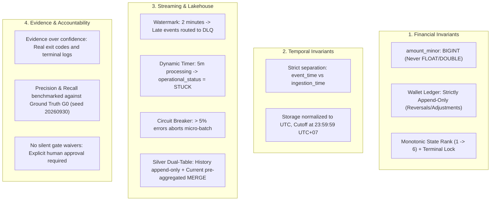

# AI-Assisted Architecture Mentorship, Implementation & QA/QC System

> **Platform:** Google Antigravity / Gemini CLI (`antigravity-cli`)  
> **Repository:** `digital-payments-lakehouse`  
> **Architecture Standards:** Integrated implementation derived from [`docs/DE_Project2_Master_Handoff.md`](file:///c:/DE-project/digital-payments-lakehouse/docs/DE_Project2_Master_Handoff.md), [`AGENTS.md`](file:///c:/DE-project/digital-payments-lakehouse/AGENTS.md), and modern open-source agent ecosystems (`vudovn/ag-kit`, `github/spec-kit`, `omer-metin/skills-for-antigravity`, `cemalcici/data-engineer-agent-kit`).

---

## 1. System Overview & Dual-Engine Mission

The `.agents/` directory hosts a repository-local, domain-adaptive AI **Mentorship, Implementation, and Quality Assurance** system.

It operates on a **Dual-Engine Model**:
1. **Engine 1: Architectural Mentorship & Education (Student Empowerment):**
   - Agent explains foundational computer science, distributed streaming mechanics, and failure traps.
   - Compares 2–3 realistic engineering options via comprehensive Trade-off Matrices (ADRs).
   - Generates "Interview Defense Cards" and "Edge-Case Challenges" to arm the student for technical interviews at top banks and fintechs (Techcombank, VPBank, Momo, Viettel, FPT).
2. **Engine 2: Production-Grade Implementation & Verification (Delivery Speed):**
   - Agent writes 100% complete, clean, and production-tested PySpark, Delta Lake, SQL, dbt, and Docker code.
   - Automatically executes local tests and captures real command logs as immutable proof of delivery.
   - Strictly enforces Lakehouse Invariants (BIGINT minor units, Append-only Ledger, Monotonic State Progression, 5% Circuit Breaker).

---

## 2. Comprehensive Directory Architecture

```text
.agents/
├── README.md                           # This architecture and operations manual
│
├── rules/                              # System guardrails & execution constraints
│   ├── system-safety-bounds.md         # PreToolUse safety hooks (protects Docker volumes & data)
│   ├── lakehouse-invariants-enforcement.md # Strict enforcement of BIGINT, Ledger & Monotonic rank
│   └── code-quality-and-style.md       # PEP 8, Pydantic v2, PySpark idioms, SQL & dbt conventions
│
├── workflows/                          # Standard operating procedures
│   ├── teach-decide-and-build.md       # [FLAGSHIP] 4-phase Mentorship + Implementation workflow
│   ├── session-resume-and-sync.md      # Fast session resume & state reconstruction workflow
│   ├── interview-prep-and-defense.md   # Mock technical interview drill & viva-voce prep
│   ├── failure-drill-and-recovery.md   # Chaos injection, outage catch-up & recovery testing
│   ├── milestone-gate-signoff.md       # Milestone transition audit (Gate 1 -> Gate 5)
│   ├── review-change.md                # Adversarial change review (Leaf / Branch / Trunk)
│   ├── streaming-dq-review.md          # Kafka, Spark Structured Streaming & Silver dual-table audit
│   ├── reconciliation-batch-review.md  # Airflow EOD, dbt 3-Way Reconciliation & CSV v1/v2 audit
│   └── launch-readiness-review.md      # Cloud showcase & portfolio release readiness
│
├── skills/                             # Progressive disclosure domain skills
│   ├── de-architect-mentor/            # Deep-dive engine mechanics, naive traps & trade-off ADRs
│   │   ├── SKILL.md
│   │   └── resources/tradeoff-rubric.md
│   ├── de-implementer/                 # Senior engineering builder (production code & test runner)
│   │   ├── SKILL.md
│   │   └── resources/pydantic-spark-patterns.md
│   ├── lakehouse-streaming-engine/     # Kafka KRaft, Spark Structured Streaming, Watermarks & Delta
│   │   ├── SKILL.md
│   │   └── resources/streaming-failure-modes.md
│   ├── financial-reconciliation-dbt/   # 3-Way Reconciliation, 7 Break Types & Airflow gates
│   │   ├── SKILL.md
│   │   └── resources/reconciliation-break-patterns.md
│   ├── de-memory-sync/                 # Cross-session context sync, ADR logging & task state tracking
│   │   └── SKILL.md
│   ├── de-troubleshooter-and-debug/    # Fast diagnostic playbook for Docker, Kafka, MinIO, Spark
│   │   └── SKILL.md
│   ├── de-qa-qc-orchestrator/          # Master review coordinator & evidence consolidator
│   ├── de-engineering-reviewer/        # Adversarial code & failure-scenario auditor
│   ├── de-data-correctness-qa/         # Data contracts, BIGINT invariants & G0 benchmarking
│   └── de-operational-readiness/       # Streaming SLOs, dynamic timers, circuit breakers & recovery
│
├── memory/                             # Persistent cross-session knowledge base
│   ├── MEMORY.md                       # Long-term knowledge: SSOT anchor, hardware, invariants
│   ├── decisions.md                    # Decision log: confirmed ADRs & architectural trade-offs
│   └── active-context.md               # Active scratchpad: current milestone, active task & next step
│
└── templates/                          # Standardized artifact outputs
    ├── task-adr-and-tradeoffs.md       # Standardized ADR, options & trade-off matrix template
    ├── interview-defense-card.md       # Interview talking points & edge-case challenge card
    ├── execution-evidence-log.md       # Verifiable command and test execution log
    ├── failure-drill-report.md         # Chaos testing & recovery trace report
    ├── change-review-report.md         # Comprehensive PR / Task review report
    ├── finding-card.md                 # Granular issue specification card
    ├── g0-evaluation-report.md         # Precision & Recall evaluation against Simulator Ground Truth
    └── milestone-gate-report.md        # Milestone quality gate sign-off report
```

---

## 3. Skill & Role Matrix

| Skill Name | Core Responsibility | Key Deliverables |
| :--- | :--- | :--- |
| **`de-architect-mentor`** | Explains engine mechanics under the hood; exposes naive failure traps; evaluates 2-3 engineering options. | Task ADRs, Trade-Off Matrices, Interview Defense Cards. |
| **`de-implementer`** | Implements production-grade, typed, and clean code; writes unit/integration tests; executes terminal commands. | Executable code files, Pytest suites, Execution Evidence Logs. |
| **`lakehouse-streaming-engine`** | Handles real-time streaming: Kafka partitions, 2m Watermarks, ForeachBatch collapse, Dual-Table Silver. | Streaming pipelines, Watermark deduplication, Dynamic timers. |
| **`financial-reconciliation-dbt`** | Handles batch EOD reconciliation: 3-Way matching (Level 1->3), 7 Break categories, Versioned replay. | dbt SQL models, Airflow DAG sensors, G0 precision/recall audits. |
| **`de-troubleshooter-and-debug`** | Diagnoses local container health, Kafka offset lag, MinIO connectivity, and PySpark memory errors. | Rapid triage, corrective terminal commands, system health recovery. |
| **`de-memory-sync`** | Manages cross-session context restoration, automatic ADR logging to decisions.md, and active WBS state progression. | Updated active-context.md, appended decisions.md records. |
| **`de-engineering-reviewer`** | Takes an adversarial review stance; uncovers race conditions, data skews, and unhandled edge cases. | Finding Cards, Blocker/High classifications, PR sign-offs. |
| **`de-qa-qc-orchestrator`** | Coordinates end-to-end task reviews, assesses centrality (Leaf/Branch/Trunk), and renders gate decisions. | Change Review Reports, Milestone Gate Reports. |

---

## 4. Standard Task Workflow: `teach-decide-and-build`

For every WBS task, the workflow executes across 4 sequential phases:



---

## 5. Technical Invariants (Zero Exceptions)

All code and designs strictly enforce the non-negotiable mandates in `AGENTS.md`:



---

## 6. How to Trigger Workflows

### 6.1. Start a New Task (Teach, Decide & Build)
```text
Execute the teach-decide-and-build workflow for task [e.g., WBS-M1-T01].
1. Deep-dive into Kafka KRaft dual-listener and MinIO S3 API mechanics.
2. Present the ADR comparing service configurations and trade-offs.
3. Implement docker-compose.yml and run container healthchecks.
4. Provide Interview Defense Points and the edge-case challenge.
```

### 6.2. Run an Interview Defense Drill
```text
Execute the interview-prep-and-defense workflow for Milestone [X].
Simulate a Senior Technical Interviewer at Techcombank/Momo and challenge my design choices, failure scenarios, and financial invariants.
```

### 6.3. Execute a Chaos / Failure Recovery Drill
```text
Execute the failure-drill-and-recovery workflow for Drill [e.g., DRILL-M3-C07].
Inject a 15-minute streaming outage, verify catch-up rate, and confirm zero duplicate transactions.
```
