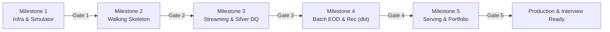

# Workflow: Launch & Milestone Gate Readiness Review

> **Purpose:** Formal review procedure to assess whether a milestone deliverable is ready to pass its Quality Gate and whether the project is ready for portfolio packaging or cloud showcase.  
> **Key References:** [`docs/wbs/README.md`](file:///c:/DE-project/digital-payments-lakehouse/docs/wbs/README.md) and [`docs/DE_Project2_Master_Handoff.md`](file:///c:/DE-project/digital-payments-lakehouse/docs/DE_Project2_Master_Handoff.md).

---

## Milestone Quality Gates Overview

---

## Gate-Specific Verification Protocols

### Gate 1 Sign-Off (Milestone 1 -> Milestone 2)
- [ ] Docker Compose starts all services with zero manual hacks (`docker compose up -d`).
- [ ] Kafka KRaft broker passes health checks on ports `9092` and `29092`.
- [ ] Kafka UI is accessible at `http://localhost:8080`.
- [ ] MinIO initializes buckets: `bronze`, `silver`, `gold`, `ground-truth`, `checkpoints`.
- [ ] Simulator produces identical SHA-256 hash when run with same seed (`20260930`).
- [ ] Ground Truth `G0` file is generated with 100% classification of injected faults.
- [ ] Pytest unit test suite passes with 0 failures (`pytest tests/unit/`).

### Gate 2 Sign-Off (Milestone 2 -> Milestone 3)
- [ ] Spark Structured Streaming job connects to Kafka `payment.events.raw`.
- [ ] Raw JSON events are written append-only to Delta Lake `bronze_payment_events`.
- [ ] Streaming checkpoint recovers cleanly from abrupt restart without losing offsets.
- [ ] Partitioning scheme (`date=YYYY-MM-DD`) verified in MinIO object storage.

### Gate 3 Sign-Off (Milestone 3 -> Milestone 4)
- [ ] Silver Dual-Table operational: `silver_payment_events_history` (deduplicated) and `silver_transactions_current` (collapsed pre-aggregated MERGE).
- [ ] Circuit Breaker aborts job when micro-batch poison rate exceeds 5% (with $\ge 50$ rows).
- [ ] Events older than 2 minutes route to `silver_late_events_dlq`.
- [ ] Dynamic Timer detects `STUCK` status after 5 minutes and unsticking audit operates accurately.
- [ ] Gold RT Channel Metrics compute 1m/5m windows and Hysteresis recovers only after 2 clean windows.
- [ ] Freshness SLO verified: p95 <= 30s under baseline load (5 events/sec).

### Gate 4 Sign-Off (Milestone 4 -> Milestone 5)
- [ ] Airflow Completeness Gate flags missing files as `INCOMPLETE` at 01:00 AM T+1.
- [ ] Grace Period SLA raises `CRITICAL_SLA_BREACH` only after 06:00 AM T+1.
- [ ] Version-aware ingestion handles amended CSV files (`v2`) cleanly without overwriting `v1`.
- [ ] dbt 3-Way Reconciliation classifies all breaks into the 7 standard categories.
- [ ] G0 benchmark demonstrates Precision $\ge 99\%$ and Recall $\ge 98\%$.
- [ ] Databricks Cloud Showcase: Batch models execute successfully on Databricks Free Edition + AWS S3 with execution logs captured.

### Gate 5 Sign-Off (Milestone 5 -> Portfolio Ready)
- [ ] Metabase dashboards functional: Payment Ops Near-RT and Finance Reconciliation EOD.
- [ ] Scale Benchmark (1M to 5M transactions) executed with throughput and compaction metrics recorded.
- [ ] Architecture Decision Records (ADRs) completed for C02, C15, and C18 in `docs/adr/`.
- [ ] English Portfolio README completed, featuring architecture diagrams, failure drills, and key trade-off explanations.

---

## Output Contract

The review lead generates a **Milestone Gate Report** using `.agents/templates/milestone-gate-report.md`.
Transitions require human mentor sign-off before proceeding to the next milestone.
