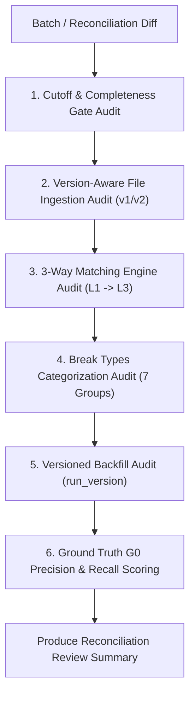

# Workflow: Batch EOD & 3-Way Reconciliation Review

> **Purpose:** Specialized review workflow for Airflow DAGs, Batch CSV ingestion, 3-Way Financial Reconciliation, dbt transformation models, and Ground Truth G0 benchmarking.  
> **Key Focus Milestone:** Milestone 4 (Batch EOD Ingestion, 3-Way Reconciliation & Cloud Showcase).

---

## Targeted Validation Protocol



### 1. EOD Cutoff & Airflow Completeness Gate (FR-REC-01..04, Q46)
- Verify cutoff evaluates at `23:59:59 Asia/Ho_Chi_Minh (UTC+07:00)`.
- Inspect the Airflow Completeness Gate task (runs at `01:00 AM T+1`):
  - Must check for the presence of all 3 mandatory datasets:
    1. Internal Wallet Ledger CDC (`S2`)
    2. Partner Clearing Settlement CSV (`S4 - Partner A`)
    3. Bank Statement CSV (`S4 - Partner B`)
  - If any dataset is missing:
    - Must set `run_status = INCOMPLETE`.
    - Must NOT execute matching models and report a false success.
- Verify Grace Period SLA:
  - System polls until `06:00 AM T+1`.
  - If still incomplete at 06:00 AM, trigger `CRITICAL_SLA_BREACH`.

### 2. Version-Aware File Ingestion (FR-REC-05..09, Q39)
- Inspect partner file ingestion logic for amended or corrected files (`v2`):
  - Files must be stored Append-Only with metadata (`file_id`, `file_version`, `ingestion_time`).
  - Active flag (`is_active = TRUE`) must only be assigned to the latest valid file version.
  - Previous versions (`v1`) must be retained for financial auditability.

### 3. 3-Way Reconciliation Matching Hierarchy (Q38)
Inspect dbt SQL models for the 3-level matching hierarchy:
- **Level 1 (Exact Match):** Primary key alignment on `transaction_id`, `settlement_id`, and `bank_reference`. Amounts must match to the exact integer minor unit (`amount_minor`).
- **Level 2 (Composite Match):** Fallback alignment when external references differ:
  - Match on `amount_minor` + `payment_channel` + `settlement_date` within a +/- 1 day tolerance window.
- **Level 3 (Break Categorization):** Remaining unmatched records must be classified into the 7 standard Break Types.

### 4. Break Types Categorization Audit
Confirm that every break in `gold_eod_reconciliation_details` maps to one of the 7 standard types:
1. `MATCHED`: Valid reconciliation across all sources.
2. `MISSING_IN_PARTNER`: In internal ledger and bank, missing in partner CSV.
3. `MISSING_IN_BANK`: In internal ledger and partner, missing in bank statement.
4. `ORPHAN_EXTERNAL`: In partner or bank, missing in internal ledger.
5. `DUPLICATE`: Multiple external claims for a single internal transaction.
6. `AMOUNT_MISMATCH`: Identifiers match, but `amount_minor` differs.
7. `TIMING_CUTOFF_MISMATCH`: Transaction crossed the `23:59:59` boundary and settled on the next business day.

### 5. Versioned Backfill & Replay (FR-PLAT-01, Q22)
- When a reconciliation job is rerun for a historical date (e.g., `T-5`):
  - The job MUST NOT update or overwrite existing records.
  - It MUST generate an incremented `run_version` (`v2`, `v3`).
  - Gold serving views must automatically select `max(run_version)` for each `business_date`.

### 6. Ground Truth G0 Automated Benchmark
- Run the G0 evaluation script against the reconciliation output:
  ```bash
  python -m src.qa.evaluate_reconciliation \
    --ground-truth data/ground_truth/G0_events_seed_20260930.jsonl \
    --reconciliation-run-id run_20261015_v1
  ```
- Verify Precision, Recall, and F1-score:
  - Precision must be $\ge 99\%$ (minimal false break accusations).
  - Recall must be $\ge 98\%$ (catches virtually all injected breaks).
