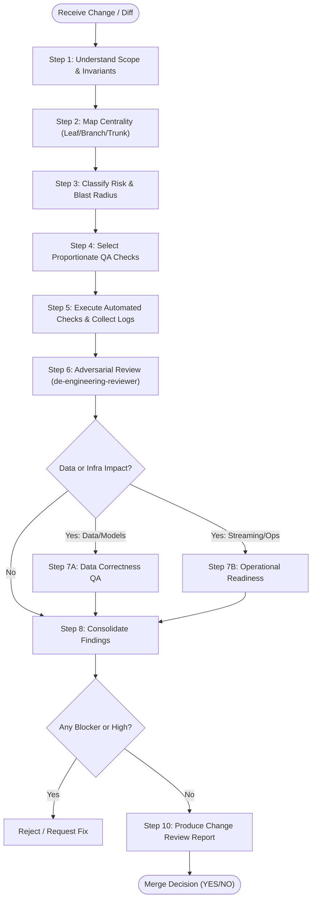

# Workflow: Universal Change Review

> **Purpose:** Standard procedure for reviewing any code diff, bug fix, feature branch, or refactor in `digital-payments-lakehouse`.  
> **Applicability:** All WBS tasks and ad-hoc changes.

---

## Workflow Steps

### Step 1: Understand Scope & Technical Invariants
- Read the change description and inspect the git diff.
- Verify whether the change touches financial values (`amount_minor`), state machine logic, timestamps, or Delta tables.
- Cross-reference with `AGENTS.md` to ensure no non-negotiable invariant is violated.

### Step 2: Determine Tree Centrality
- **Leaf:** Isolated utility, standalone CLI parser, helper script.
- **Branch:** Isolated source adapter, specific dbt staging model, dedicated Airflow operator.
- **Trunk:** Core data models (`models.py`), Delta Lake schema definitions, Monotonic State progression logic, 3-Way Reconciliation matching engine, `config/config.yaml`.

### Step 3: Classify Risk Level
- Estimate risk based on Blast Radius, Centrality, and Reversibility:
  - **Low:** Leaf component; changes are reversible and isolated.
  - **Medium:** Bounded Branch component; touches specific transformations.
  - **High:** Trunk component; changes core lakehouse state, contracts, or financial logic.
  - **Critical:** Destructive migrations, credential handling, or irreversible data writes.

### Step 4: Formulate the Validation Plan
- Identify applicable automated checks:
  - Static Analysis & Linting (e.g., `ruff check`, `mypy`).
  - Unit Tests (e.g., `pytest tests/unit/`).
  - Integration Tests (e.g., `pytest tests/integration/`).
  - Data Quality / Contract checks.
- Do not run irrelevant heavy integration suites for minor Leaf changes.

### Step 5: Execute Checks & Collect Real Evidence
- Run the selected commands in the workspace terminal.
- Capture exact command invocations, exit codes, and output summaries.
- Explicitly record all checks as `PASS`, `FAIL`, `NOT RUN`, or `NOT APPLICABLE`.
- If a test cannot run, document the exact reason (e.g., missing Docker daemon).

### Step 6: Perform Adversarial Review (`de-engineering-reviewer`)
- Challenge code assumptions:
  - What happens on empty data? Malformed JSON? Duplicate message?
  - Can integer overflow occur? Is money float-free?
  - Are exceptions swallowed silently?
  - Does the test suite assert business requirements or simply mirror the implementation?

### Step 7: Perform Domain-Specific Reviews
- **Data Correctness (`de-data-correctness-qa`):** If schemas, transformations, or reconciliation algorithms changed, verify grain, keys, idempotency, and Ground Truth `G0` alignment.
- **Operational Readiness (`de-operational-readiness`):** If streaming queries, Docker Compose, or Airflow DAGs changed, verify SLOs, checkpoints, dynamic timers, and recovery paths.

### Step 8 & 9: Consolidate Findings & Enforce Gates
- Compile findings into standard Finding Cards (`BLOCKER`, `HIGH`, `MEDIUM`, `LOW`, `OBSERVATION`).
- If any `BLOCKER` or `HIGH` findings exist:
  - **Merge-Ready Verdict = NO**.
  - Halt progression until fixed or formally waived by the human mentor.

### Step 10: Generate Final Report
- Populate `.agents/templates/change-review-report.md`.
- Present clear **Merge-Ready** and **Launch-Ready** verdicts to the human engineer.
