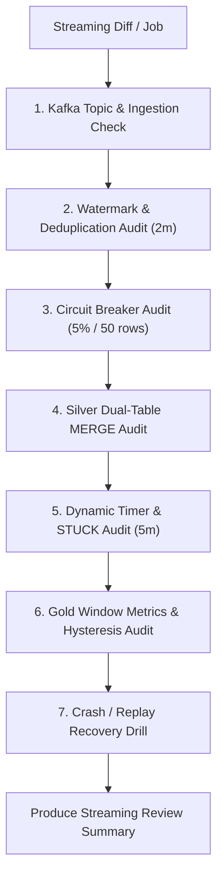

# Workflow: Streaming Pipeline & Real-Time DQ Review

> **Purpose:** Specialized review workflow for Kafka topics, PySpark Structured Streaming jobs, Silver Dual-Table merges, Dynamic Timer stuck detection, and Circuit Breaker mechanisms.  
> **Key Focus Milestones:** Milestone 2 (Walking Skeleton) and Milestone 3 (Stateful Streaming & Silver DQ).

---

## Targeted Validation Protocol



### 1. Kafka Ingestion & Offset Management
- Confirm Kafka topic partitions and replication factor match `docker/docker-compose.yml`.
- Verify listener configuration (`localhost:9092` for host, `kafka:29092` for containers).
- Verify checkpoint location is isolated, non-temporary, and persistent across container restarts.

### 2. Watermark & Lateness Verification (NFR-RT-03)
- Verify `withWatermark("event_time", "2 minutes")` is correctly declared on event-time.
- Confirm late-arriving events older than 2 minutes are NOT discarded into the void:
  - Must route to `silver_late_events_dlq`.
  - Must be partitioned or structured for EOD batch reconciliation / correction.

### 3. Circuit Breaker Verification (NFR-DQ-01)
- Inspect the error rate calculation in `foreachBatch`:
  ```python
  error_rate = error_count / total_count
  if total_count >= 50 and error_rate > 0.05:
      raise CircuitBreakerTrippedException(f"Error rate {error_rate:.2%} exceeded threshold 5%")
  ```
- Ensure poison records (negative amounts, null PKs, invalid enums) route to `silver_quarantine_events`.
- Verify the job fails fast when the threshold is breached, preventing corrupted writes to Delta tables.

### 4. Silver Dual-Table MERGE Logic (Q44)
- **`silver_payment_events_history` (Append-Only):**
  - Verify every valid state event is written append-only.
  - Verify deduplication on `event_id`.
- **`silver_transactions_current` (1 row per transaction):**
  - Verify pre-aggregation: multiple events for the same `transaction_id` within the micro-batch must be collapsed by Monotonic State Rank before executing `MERGE`.
  - Verify `MERGE` condition prevents duplicate key exceptions and state regressions.
  - Verify terminal events (`COMPLETED`, `FAILED`, `CANCELLED`, `EXPIRED`) lock the record; conflicting terminal events must route to `silver_lifecycle_exceptions`.

### 5. Dynamic Timer & Stuck Transaction Logic (FR-LC-01..05)
- Verify calculation of `deadline = last_progress_event_time + 300 seconds`.
- If current processing timestamp $> deadline$ while in `PROCESSING`:
  - Verify `operational_status` is updated to `STUCK`.
  - Verify `lifecycle_state` remains `PROCESSING`.
- Verify unsticking behavior: when a late terminal event arrives:
  - Advance `lifecycle_state` to the terminal state.
  - Clear `operational_status = NORMAL`.
  - Set `was_ever_stuck = TRUE` in audit history.

### 6. Gold RT Channel Metrics & Hysteresis (FR-OPS-01..04)
- Verify 1-minute and 5-minute sliding window aggregations for `gold_rt_channel_metrics`.
- Verify Partner Degradation trigger logic (Success Rate $< 90\%$ OR baseline drop $\ge 8\%$, volume $\ge 20$ / $\ge 100$).
- Verify anti-flapping **Hysteresis Recovery**: alert clears ONLY after 2 consecutive windows with Success Rate $\ge 95\%$.

### 7. Recovery & Replay Verification
- Test container kill simulation:
  ```bash
  docker compose stop spark-streaming
  docker compose start spark-streaming
  ```
- Verify job resumes from the last committed Delta transaction without dropping records or corrupting the `silver_transactions_current` table.
