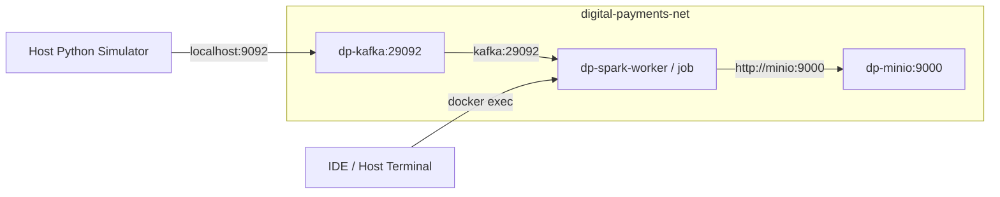

# MILESTONE 2 SPECIFICATION & EXECUTION BLUEPRINT
## The "Walking Skeleton" — Kafka to Delta Lake Bronze Ingestion

> **Document Status:** APPROVED FOR IMPLEMENTATION  
> **Target Layer:** Bronze Medallion Layer (`bronze_payment_events`)  
> **Source Topic:** `payment.events.raw` (3 Partitions, Key: `transaction_id`)  
> **Storage Target:** MinIO S3A (`s3a://bronze/payment_events`)  
> **Engine:** Apache Spark Structured Streaming 3.5.x + Delta Lake 3.2.x  

---

## 1. Executive Summary & Objective

Milestone 2 hiện thực hóa lát cắt dọc đầu tiên (**Vertical Slice 1 — The Walking Skeleton**) trong lộ trình Phase 9. Mục tiêu là thiết lập và kiểm chứng một luồng truyền nhận dữ liệu mỏng chạy thông suốt từ đầu đến cuối:

```
[Simulator S1] 
     │
     ▼ (Keyed by tx_id)
[Kafka: payment.events.raw] 
     │
     ▼ (Micro-batch: 5s / availableNow)
[Spark Structured Streaming] 
     │
     ▼ (Append-only + Checkpoint)
[Delta Lake: s3a://bronze/payment_events]
```

### Tại sao bước này quyết định sự thành bại của hệ thống?
1. **Kiểm chứng tính toàn vẹn của Transaction Log trên Object Storage:** MinIO là Object Storage (không hỗ trợ atomic directory rename nguyên bản như HDFS). Delta Lake sử dụng cơ chế Log-Store (`io.delta.storage.S3DynamoDBLogStore` hoặc mặc định atomic multi-part upload) để đảm bảo không xảy ra partial writes hay race conditions.
2. **Khóa chặt nguyên tắc Bất biến tầng Bronze:** Dữ liệu thô được ghi nhận 100% không qua bất kỳ bộ lọc nghiệp vụ nào, bảo toàn giá trị phục vụ Audit và Replay.
3. **Cơ chế Phục hồi sự cố (Crash Recovery):** Tách biệt checkpoint location (`s3a://checkpoints/bronze_payment_events`) để job có thể dừng/bật lại bất kỳ lúc nào mà không gây trùng lặp bản ghi hay mất offset.

---

## 2. Kiến trúc Hạ tầng Spark Lakehouse (Docker Integration)

### 2.1. Phân tích Ranh giới Mạng & Kết nối (Network & Boundaries)



- **Kafka Ingestion Endpoint:** `kafka:29092` (mạng nội bộ Docker).
- **MinIO Storage Endpoint:** `http://minio:9000`.
- **MinIO Credentials:** `admin` / `password123`.

### 2.2. Các Gói Thư viện Phụ thuộc (Dependencies & JARs)
Để Spark 3.5.x có thể tương tác với Kafka và Delta Lake MinIO S3A, cần các gói Maven JARs:
- `org.apache.spark:spark-sql-kafka-0-10_2.12:3.5.3`
- `io.delta:delta-spark_2.12:3.2.0`
- `org.apache.hadoop:hadoop-aws:3.3.4`
- `com.amazonaws:aws-java-sdk-bundle:1.12.262`

### 2.3. Cấu hình Hadoop S3A bắt buộc cho MinIO:
```python
spark_conf = {
    "spark.sql.extensions": "io.delta.sql.DeltaSparkSessionExtension",
    "spark.sql.catalog.spark_catalog": "org.apache.spark.sql.delta.catalog.DeltaCatalog",
    "spark.hadoop.fs.s3a.endpoint": "http://minio:9000",
    "spark.hadoop.fs.s3a.access.key": "admin",
    "spark.hadoop.fs.s3a.secret.key": "password123",
    "spark.hadoop.fs.s3a.path.style.access": "true",
    "spark.hadoop.fs.s3a.impl": "org.apache.hadoop.fs.s3a.S3AFileSystem",
    "spark.hadoop.fs.s3a.connection.ssl.enabled": "false",
    "spark.hadoop.fs.s3a.aws.credentials.provider": "org.apache.hadoop.fs.s3a.SimpleAWSCredentialsProvider",
}
```

---

## 3. Data Contract: `bronze_payment_events`

Theo SRS Section 3.2 và 5.3:

### 3.1. Schema Specification

| Cột | Kiểu dữ liệu | Mô tả |
| :--- | :--- | :--- |
| `kafka_key` | `StringType()` | Khóa phân vùng từ Kafka (`transaction_id`) |
| `kafka_topic` | `StringType()` | Tên topic (`payment.events.raw`) |
| `kafka_partition` | `IntegerType()` | Partition index (0, 1, 2) |
| `kafka_offset` | `LongType()` | Offset vật lý của bản ghi trong partition |
| `kafka_timestamp` | `TimestampType()` | Thời điểm Kafka tiếp nhận message |
| `raw_payload` | `StringType()` | Chuỗi JSON nguyên bản không cắt xén |
| `event_id` | `StringType()` | UUID của sự kiện (extract nhanh để query) |
| `transaction_id` | `StringType()` | UUID định danh giao dịch |
| `event_type` | `StringType()` | Bậc trạng thái (INITIATED, PROCESSING, COMPLETED...) |
| `event_time` | `TimestampType()` | Thời gian sự kiện nghiệp vụ xảy ra (UTC) |
| `ingestion_time` | `TimestampType()` | Thời gian simulator gửi sự kiện (UTC) |
| `ingestion_date` | `StringType()` | Partition column (`YYYY-MM-DD` suy từ ingestion_time) |
| `ingested_at_bronze` | `TimestampType()` | Thời điểm Spark ghi thành công vào Delta Lake |

### 3.2. Chiến lược Phân vùng & Ghi (Partitioning & Storage Rules)
- **Partition By:** `ingestion_date` (Tránh tạo quá nhiều thư mục nhỏ, tối ưu cho các truy vấn quét dữ liệu theo ngày chốt sổ EOD).
- **Output Mode:** `Append` (Chỉ thêm mới, không ghi đè, không cập nhật).
- **Checkpoint Location:** `s3a://checkpoints/bronze_payment_events`.
- **Target Table Location:** `s3a://bronze/payment_events`.

---

## 4. Kế hoạch Triển khai (Step-by-step Implementation Plan)

### Task 2.1: Cấu hình Spark Container Service
1. Tạo `docker/spark/Dockerfile` tối ưu dựa trên nền tảng Linux kèm Spark 3.5.3, Python 3.12, và cài sẵn các JARs hoặc cấu hình tự động nạp qua `spark.jars.packages`.
2. Bổ sung service `spark` vào [docker/docker-compose.yml](file:///c:/Users/ADMIN/DE-project/digital-payments-lakehouse/docker/docker-compose.yml).
3. Mount toàn bộ source code `./src` và `./config` vào thư mục `/app` trong container.

### Task 2.2: Xây dựng Module Ingestion
Tạo file [src/digital_payments_lakehouse/bronze/ingest_payment_events.py](file:///c:/Users/ADMIN/DE-project/digital-payments-lakehouse/src/digital_payments_lakehouse/bronze/ingest_payment_events.py):
- Hàm `get_spark_session()`: Khởi tạo Spark Session với Delta & S3A configs.
- Hàm `read_kafka_stream(spark)`: Khởi tạo DataStreamReader từ Kafka.
- Hàm `transform_raw_to_bronze(df)`: Trích xuất metadata và thêm cột `ingestion_date`, `ingested_at_bronze`.
- Hàm `write_bronze_stream(df)`: Ghi ra Delta Lake kèm checkpoint và cấu hình Trigger.

### Task 2.3: Thực nghiệm End-to-End & Thu thập Bằng chứng
1. Kích hoạt Simulator sinh 50 giao dịch vào Kafka.
2. Khởi chạy Spark Ingestion Job (chạy chế độ `availableNow=True` hoặc streaming 5s).
3. Chạy script kiểm tra [src/digital_payments_lakehouse/bronze/verify_bronze.py](file:///c:/Users/ADMIN/DE-project/digital-payments-lakehouse/src/digital_payments_lakehouse/bronze/verify_bronze.py) để:
   - Đọc bảng Delta `s3a://bronze/payment_events`.
   - In schema, số lượng bản ghi và 5 dòng dữ liệu mẫu.
   - Kiểm tra cấu trúc thư mục MinIO `mc ls local/bronze/payment_events/` và `_delta_log/`.

---

## 5. Tiêu chí Nghiệm thu (Definition of Done - Gate 2)

- [ ] **DoD-01:** Container Spark hoạt động ổn định, kết nối được cả `kafka:29092` và `http://minio:9000`.
- [ ] **DoD-02:** File checkpoint sinh ra đầy đủ tại `s3a://checkpoints/bronze_payment_events/offsets/` và `commits/`.
- [ ] **DoD-03:** Bảng Delta `s3a://bronze/payment_events` chứa thư mục `_delta_log/00000000000000000000.json`.
- [ ] **DoD-04:** Dữ liệu phân vùng chuẩn theo thư mục `ingestion_date=YYYY-MM-DD/`.
- [ ] **DoD-05:** Tổng số dòng trong bảng Delta Bronze bằng chính xác tổng số sự kiện sinh ra từ Simulator.
