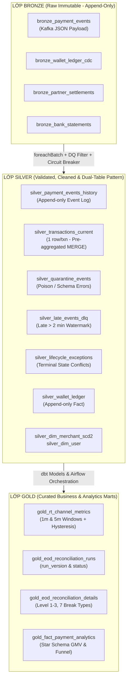

# WBS DICTIONARY & TECHNICAL INVARIANTS SPECIFICATION

> **Hệ thống:** Digital Payments Monitoring & 3-Way Reconciliation Lakehouse Platform  
> **Tài liệu tham chiếu gốc (SSOT):** [`docs/DE_Project2_Master_Handoff.md`](file:///c:/DE-project/digital-payments-lakehouse/docs/DE_Project2_Master_Handoff.md)  
> **Tài liệu điều phối tổng quan:** [`docs/wbs/README.md`](file:///c:/DE-project/digital-payments-lakehouse/docs/wbs/README.md)  
> **Vai trò điều hành:** Senior Technical Project Manager (TPM) & Lead Data Platform Architect  
> **Trạng thái:** Confirmed / Technical Standard Mandate  
> **Phiên bản:** v1.0

---

## 1. WBS TASK SPECIFICATION SCHEMA (MẪU CHUẨN CỦA 1 TASK KỸ THUẬT)

Mọi gói việc (Task) trong các tài liệu Milestone từ M1 đến M5 bắt buộc phải tuân thủ nghiêm ngặt cấu trúc đặc tả chuẩn hóa dưới đây. Định dạng này đảm bảo tính tường minh kỹ thuật, tính độc lập trong kiểm thử và khả năng chuyển giao trực tiếp cho kỹ sư thực thi mà không có sự mơ hồ.

### 1.1. Cấu trúc Thuộc tính Chuẩn (Task Field Schema)

```markdown
### [WBS-M{X}-T{YY}] {Tên Task Ngắn gọn, Rõ hành động}

- **Classification:** `[D1-Implement+Test]` | `[D2-Core]` | `[D3-ADR]`
- **Estimated Effort:** {Số giờ dự toán, ví dụ: 4 hours}
- **Prerequisites / Dependencies:** {Danh sách WBS ID tiền đề, ví dụ: WBS-M1-T01, WBS-M1-T02}
- **Input Artifacts:** {File cấu hình, Pydantic contracts, Topic Kafka, bảng Delta upstream...}
- **Detailed Implementation Steps:**
  1. {Bước 1: Thiết kế cấu trúc thư mục, module, interface...}
  2. {Bước 2: Chi tiết logic xử lý dữ liệu, thư viện sử dụng, xử lý edge case...}
  3. {Bước 3: Ghi nhận log, metadata, xử lý lỗi...}
- **Deliverables / Output Artifacts:** {Đường dẫn file mã nguồn, Delta table, dbt model, DAG ID...}
- **Evidence to Capture & Storage Directory:**
  - **Directory:** `docs/evidence/m{X}/wbs-m{X}-t{YY}/`
  - **Artifacts:**
    - `logs/`: {Terminal execution log, container logs, pytest outputs, e.g. `pytest_output.txt`}
    - `screenshots/`: {UI snapshots: Kafka UI, Spark UI, MinIO Console, Metabase Dashboards, e.g. `kafka_ui_topics.png`}
    - `data_samples/`: {Sample payloads, JSONL extracts, Delta history inspection, hash outputs, e.g. `g0_sample_100_rows.jsonl`}
- **Definition of Done (DoD) & Acceptance Criteria (AC):**
  - [ ] **AC-1:** {Tiêu chí định lượng, testable thứ nhất}
  - [ ] **AC-2:** {Tiêu chí định lượng, testable thứ hai}
  - [ ] **AC-3:** {Tiêu chí định lượng, testable thứ ba}
- **Verification Method:**
  ```bash
  # Chuỗi lệnh CLI, pytest, dbt test hoặc SQL truy vấn Delta log dùng để kiểm chứng
  ```
- **Potential Risks & Mitigation:**
  - *Risk:* {Mô tả rủi ro kỹ thuật, OOM, sai lệch dữ liệu, concurrency...}
  - *Mitigation:* {Biện pháp phòng ngừa hoặc cấu hình xử lý cụ thể}
```

### 1.2. Phân loại Task (Classification Details)
- **`[D1-Implement+Test]` (Production-Ready Code, Automated Test & Evidence):** Các tính năng cốt lõi bắt buộc phải có code triển khai hoàn chỉnh, bộ unit/integration tests tự động với coverage cao, kèm bằng chứng thực thi (execution log, Delta log snapshot, screenshot) để đóng gói vào Portfolio CV.
- **`[D2-Core]` (Core Mechanism Implementation):** Các cơ chế nền tảng của hệ thống (như CDC ingestion, partitioning/compaction, schema evolution safety, retry policy). Cần code hoàn chỉnh và kiểm thử tích hợp thông suốt luồng.
- **`[D3-ADR]` (Design & Architecture Decision Record):** Các bài toán thiết kế kiến trúc phức tạp hoặc trade-off sâu (như Near-duplicate fuzzy matching, late financial adjustments as-of reporting, PII masking design). Cần có văn bản ADR chuẩn quốc tế trong thư mục `docs/adr/`.

---

### 1.3. Ví dụ Minh họa Mẫu Chuẩn (Canonical Reference Task Example)

Dưới đây là một Task chuẩn mực được trích xuất từ Milestone 1 làm hình mẫu tham chiếu (Gold Standard Reference) cho toàn bộ các Task sau này:

```markdown
### [WBS-M1-T02] Develop Deterministic Payment Event Simulator with Error Injection & Ground Truth G0

- **Classification:** `[D1-Implement+Test]`
- **Estimated Effort:** 8 hours
- **Prerequisites / Dependencies:** WBS-M1-T01 (Repo Layout & Base Configs)
- **Input Artifacts:**
  - `config/config.yaml` (Simulation parameters: seed, transactions_per_second, error_rates).
  - Domain specs: S1 Payment Gateway Event Stream schema trong `docs/DE_Project2_Master_Handoff.md`.
- **Detailed Implementation Steps:**
  1. Cài đặt Pydantic v2 model `PaymentEvent` trong `src/simulator/models.py` với đầy đủ trường: `event_id`, `transaction_id`, `event_type`, `event_time`, `ingestion_time`, `user_id`, `merchant_id`, `payment_channel`, `payment_method`, `amount_minor` (BIGINT), `currency`, `status_reason`, `producer_version`.
  2. Xây dựng State Machine trong `src/simulator/lifecycle.py` quản lý chuyển trạng thái theo Monotonic State Rank:
     `INITIATED (1)` -> `PAYMENT_METHOD_SELECTED (2)` -> `AUTHORIZED (3)` -> `PROCESSING (4)` -> `COMPLETED (5) | FAILED (5) | CANCELLED (5) | EXPIRED (5)` -> `REFUNDED (6)`.
  3. Xây dựng Generator Engine `src/simulator/generator.py` nhận tham số `seed: int` cố định (sử dụng `random.Random(seed)`).
  4. Tiêm lỗi chủ động có kiểm soát (Error Injection Module):
     - Duplicate events (tỷ lệ 2%): Phát lại `event_id` với nội dung tương tự.
     - Out-of-order & Late events (tỷ lệ 3%): Phát lùi `event_time` trễ từ 3 đến 10 phút.
     - Stuck transactions (tỷ lệ 1%): Dừng sau bước `PROCESSING` không phát sinh terminal event.
     - Poison records (tỷ lệ 0.5%): Sinh `amount_minor < 0` hoặc sai kiểu dữ liệu để test Circuit Breaker.
     - Conflicting terminals (tỷ lệ 0.2%): Phát sinh cả `COMPLETED` lẫn `FAILED` cho cùng một `transaction_id`.
  5. Đồng thời xuất tệp Ground Truth `G0` (`data/ground_truth/G0_events_seed_{seed}.jsonl`) ghi nhận bản chất thật của từng giao dịch để dùng cho bước đo lường Precision / Recall tự động.
- **Deliverables / Output Artifacts:**
  - `src/simulator/models.py`, `src/simulator/lifecycle.py`, `src/simulator/generator.py`, `src/simulator/main.py`.
  - `tests/unit/test_simulator.py`.
  - Tệp mẫu `data/ground_truth/G0_events_seed_20260930.jsonl`.
- **Evidence to Capture & Storage Directory:**
  - **Directory:** `docs/evidence/m1/wbs-m1-t05/`
  - **Artifacts:**
    - `logs/simulator_seed_parity_check.log` (Log chạy 2 lần generator với seed 20260930 và hash đối chiếu).
    - `logs/pytest_test_simulator.txt` (Log kết quả chạy pytest unit test đạt 100% pass).
    - `data_samples/g0_sample_100_records.jsonl` (Trích xuất 100 dòng mẫu Ground Truth G0 chứng minh các fault types).
- **Definition of Done (DoD) & Acceptance Criteria (AC):**
  - [ ] **AC-1 (Determinism):** Chạy simulator 2 lần với cùng `--seed 20260930` và `--count 10000` tạo ra 2 tệp đầu ra giống hệt nhau 100% (kiểm tra hash SHA-256 trùng khớp).
  - [ ] **AC-2 (Schema Validity):** 100% events hợp lệ pass Pydantic validation; trường `amount_minor` là số nguyên dương `BIGINT`.
  - [ ] **AC-3 (Error Distribution):** Tỷ lệ các lỗi được tiêm nằm trong khoảng dung sai +/- 0.5% so với cấu hình trong `config.yaml`.
  - [ ] **AC-4 (Ground Truth Completeness):** 100% giao dịch có bản ghi đối soát tương ứng trong file `G0` với đầy đủ metadata phân loại lỗi.
- **Verification Method:**
  ```bash
  # Chạy test sinh dữ liệu deterministic
  pytest tests/unit/test_simulator.py -v

  # Kiểm tra tính lặp lại bằng hash SHA-256
  python -m src.simulator.main --seed 20260930 --count 1000 --out /tmp/run1.jsonl
  python -m src.simulator.main --seed 20260930 --count 1000 --out /tmp/run2.jsonl
  powershell -Command "Get-FileHash /tmp/run1.jsonl; Get-FileHash /tmp/run2.jsonl"
  ```
- **Potential Risks & Mitigation:**
  - *Risk:* Hàm random của Python sinh dữ liệu không đồng nhất giữa các phiên bản OS hoặc thư viện ngoài.
  - *Mitigation:* Sử dụng thuần túy `random.Random(seed)` của thư viện chuẩn Python built-in, đóng gói seed trong CLI argument và config YAML.
```

---

## 2. GLOBAL TECHNICAL INVARIANTS (CÁC NGUYÊN TẮC KỸ THUẬT TOÀN CỤC)

Toàn bộ kiến trúc và mã nguồn của dự án chịu sự chi phối của 3 nguyên tắc bất biến (Invariants) sau đây. Bất kỳ đoạn mã, mô hình bảng hoặc logic pipeline nào vi phạm các nguyên tắc này sẽ bị coi là **Blocker** trong các phiên Review kỹ thuật.

### 2.1. Quy chuẩn Tiền tệ (Currency Standard — Invariant #1)

```
   [NGHIÊM CẤM]  FLOAT / DOUBLE / REAL (Sai số dấu phẩy động IEEE 754)
         │
         ▼
   [BẮT BUỘC]   BIGINT / Integer Minor Units (Ví dụ: amount_minor)
```

1. **Biểu diễn Số nguyên Đơn vị Nhỏ nhất (`amount_minor`):**
   - Mọi giá trị tiền tệ trong toàn bộ các bảng dữ liệu (Kafka Payload, Bronze, Silver, Gold, dbt models, APIs) bắt buộc phải được lưu trữ dưới dạng **số nguyên 64-bit (`BIGINT` / `long`)**.
   - Tuyệt đối nghiêm cấm sử dụng các kiểu số thực dấu phẩy động (`FLOAT`, `DOUBLE`, `REAL`).
2. **Lý do Kỹ thuật & Nghiệp vụ Ngân hàng:**
   - Chuẩn số thực IEEE 754 biểu diễn số thập phân dạng nhị phân xấp xỉ (ví dụ `0.1 + 0.2 = 0.30000000000000004`). Khi thực hiện phép tính tổng (`SUM`), đối soát sổ cái hoặc tính phí trên hàng triệu giao dịch, sai số tích lũy dấu phẩy động sẽ dẫn đến chênh lệch tiền thực tế, vi phạm nguyên tắc cân bằng kế toán.
3. **Quy ước Đơn vị Tiền tệ:**
   - Đối với **VND**: Đơn vị nhỏ nhất là 1 đồng -> `amount_minor = 100000` tương ứng với `100.000 VND`.
   - Đối với ngoại tệ có số thập phân (ví dụ **USD, EUR**): Đơn vị nhỏ nhất là Cent (1/100) -> `amount_minor = 1050` tương ứng với `10.50 USD`.
4. **Phạm vi Chuyển đổi Hiển thị:**
   - Việc format sang số thập phân hoặc thêm dấu phân cách hàng nghìn chỉ được phép thực hiện tại **tầng Presentation cuối cùng** (Metabase Dashboard query hoặc UI endpoint). Toàn bộ các tầng lưu trữ và tính toán nội bộ duy trì 100% `BIGINT`.

---

### 2.2. Mô hình Thời gian & Múi giờ (Timestamp & Timezone Standard — Invariant #2)

```
                                  PIPELINE TIMELINE
   
   Business Event Occurs                              Platform Ingestion
         │                                                    │
         ▼                                                    ▼
   [ event_time ] ──────────── (Event Lateness) ─────────> [ ingestion_time ]
         │
         ├─ Dùng cho: Watermarking, Windowing (1m, 5m)
         ├─ Dùng cho: Stuck Transaction Timer (5 phút)
         └─ Dùng cho: Business Date Cutoff (23:59:59 UTC+07)
```

1. **Tách biệt Triệt để `event_time` và `ingestion_time`:**
   - `event_time` (Thời điểm sự kiện nghiệp vụ): Là mốc thời gian sự kiện thực tế phát sinh tại cổng thanh toán hoặc thiết bị của người dùng. **Toàn bộ logic nghiệp vụ** (Watermark, Cửa sổ tổng hợp 1m/5m, bộ đếm giao dịch kẹt `STUCK`, phân bổ ngày kế toán `business_date`) bắt buộc phải tính dựa trên `event_time`.
   - `ingestion_time` (Thời điểm tiếp nhận hệ thống): Là mốc thời gian nền tảng Data Lakehouse ghi nhận bản ghi tại Kafka Broker hoặc tầng Bronze.
   - Các chỉ số đo lường hiệu năng:
     * **Event Lateness:** `ingestion_time - event_time` (đo lường độ trễ từ nguồn hoặc nghẽn mạng).
     * **Data Freshness SLO:** `serving_time - event_time` (cam kết mức dịch vụ p95 <= 30s).
2. **Quy chuẩn Múi giờ Lưu trữ Nội bộ (Internal Storage UTC):**
   - 100% timestamps lưu trữ trong Delta Lake (Bronze, Silver, Gold), Kafka headers, và Airflow execution contexts bắt buộc được chuẩn hóa theo múi giờ **`UTC`** (Định dạng ISO-8601: `YYYY-MM-DDTHH:mm:ss.SSSZ`).
3. **Múi giờ Nghiệp vụ & Mốc Chốt sổ Cuối ngày (Business Cutoff):**
   - Múi giờ nghiệp vụ chốt sổ đối soát EOD quy chiếu theo giờ Việt Nam: **`Asia/Ho_Chi_Minh (UTC+07:00)`**.
   - Mốc Cutoff chốt sổ cho ngày nghiệp vụ `business_date = D`: **`D 23:59:59.999 UTC+07`** (tương đương với **`D 16:59:59.999 UTC`**).
   - Mọi giao dịch có `event_time` trong khoảng `[(D-1) 17:00:00.000 UTC, D 16:59:59.999 UTC]` được gán chính xác vào `business_date = D`.
   - **Boundary Testing:** Simulator bắt buộc tiêm các giao dịch cận biên chốt sổ (ví dụ `16:59:58 UTC` và `17:00:02 UTC`) để xác minh thuật toán phân bổ ngày kế toán không gây sai lệch đối soát giữa luồng streaming và batch.

---

### 2.3. Quy chuẩn Lưu trữ Medallion Architecture (Strict Medallion — Invariant #3)

Dự án áp dụng kiến trúc **Strict Medallion Architecture** với các quy định khắt khe về trách nhiệm và tính bất biến của từng tầng:



#### 1. Lớp Bronze (Raw Immutable Layer)
- **Append-only 100%:** Tuyệt đối không thực hiện bất kỳ thao tác `UPDATE`, `DELETE`, hoặc `MERGE` nào trên bảng Bronze.
- **Payload Preservation:** Lưu trữ nguyên vẹn dữ liệu gốc (Raw JSON string / binary) cùng toàn bộ metadata kỹ thuật đường ống (`_kafka_topic`, `_kafka_partition`, `_kafka_offset`, `_kafka_timestamp`, `_ingestion_time`, `_source_file_id`, `_source_file_version`).
- **Phân vùng (Partitioning):** Phân vùng vật lý theo `ingestion_date` (ngày tiếp nhận). Đảm bảo khả năng Replay 100% dữ liệu lịch sử từ gốc khi cần tính toán lại toàn bộ Lakehouse.

#### 2. Lớp Silver (Dual-Table Pattern & Exception Branching)
Giải quyết triệt để hai thách thức lớn nhất của streaming data lakehouse: **Hiệu năng ghi Delta Lake (tránh small files)** và **Lỗi multiple source rows matching trong câu lệnh MERGE**.
- **`silver_payment_events_history` (Append-only Event Log):**
  - Ghi nhận tuần tự mọi sự kiện chuyển trạng thái hợp lệ đã qua lọc trùng `event_id` bằng Watermark 2 phút.
  - Phục vụ truy vấn phân tích lịch sử, tái tạo hành trình giao dịch và kiểm toán (Audit Trail) thông qua SQL Window functions (`valid_from`, `valid_to`). Không bao giờ update.
- **`silver_transactions_current` (Stateful Current State Dimension):**
  - Grain vật lý: **Chính xác 1 dòng duy nhất trên mỗi `transaction_id`**.
  - **Pre-aggregation (Collapse) Pattern:** Trong mỗi micro-batch streaming (`foreachBatch`), nếu xuất hiện nhiều sự kiện của cùng một `transaction_id`, Spark job bắt buộc phải gom cụm (collapse) và chọn trạng thái có **Monotonic State Rank cao nhất (1 -> 6)** trước khi gọi lệnh `MERGE INTO`. Điều này loại bỏ hoàn toàn exception: `DeltaIllegalStateException: Cannot perform MERGE as multiple source rows matched the same target row`.
  - Quản lý trạng thái vận hành: `current_lifecycle_state`, `operational_status` (`NORMAL` vs `STUCK`), `last_progress_event_time`, `was_ever_stuck`.
- **Hệ thống Nhánh Ngoại lệ (Exception Tables):**
  - `silver_quarantine_events`: Cách ly các bản ghi vi phạm hợp đồng dữ liệu (Poison records: âm tiền, thiếu trường bắt buộc, sai định dạng enum).
  - `silver_late_events_dlq`: Lưu trữ các bản ghi đến trễ hơn Watermark (2 phút). Tuyệt đối không drop âm thầm; lưu tại DLQ để luồng Batch EOD định kỳ hợp nhất bù vào lịch sử.
  - `silver_lifecycle_exceptions`: Lưu trữ các xung đột trạng thái kết thúc (Terminal conflict, ví dụ: giao dịch đã `COMPLETED` nhưng sau đó lại nhận `FAILED`).
  - `silver_wallet_ledger`: Sổ cái tài chính bất biến. Chỉ chấp nhận các dòng ghi nhận bút toán (`INSERT`, `ADJUSTMENT`, `REVERSAL`). Cấm `UPDATE`/`DELETE` vật lý.

#### 3. Lớp Gold (Curated Business & Serving Marts)
- **`gold_rt_channel_metrics`:** Bảng tổng hợp số liệu vận hành kênh thanh toán theo cửa sổ trượt 1 phút và 5 phút. Theo dõi Freshness SLO, Success Rate và gắn nhãn suy giảm đối tác (`is_degraded`) kèm thuật toán **Hysteresis** (chỉ hủy cảnh báo khi Success Rate phục hồi >= 95% liên tục trong 2 chu kỳ).
- **`gold_eod_reconciliation_runs` & `gold_eod_reconciliation_details`:** Bảng kết quả đối soát 3 bên do dbt xây dựng. Quản lý tính lũy đẳng thông qua `run_version` (`v1`, `v2`...). Phân loại chi tiết 7 nhóm Break Types ở cấp độ từng giao dịch.
- **`gold_fact_payment_analytics`:** Bảng Fact mô hình Star Schema chuẩn Kimball, tích hợp với các chiều `dim_merchant_scd2` và `dim_user` để phục vụ BI phân tích GMV, kênh và tỷ lệ chuyển đổi.

---

## 3. GLOBAL DEFINITION OF DONE (DOD CHUẨN CỦA DỰ ÁN)

Bất kỳ tính năng hoặc gói việc WBS nào khi được chuyển sang trạng thái **Done** bắt buộc phải vượt qua bộ tiêu chí nghiệm thu toàn cục (Global DoD) dưới đây:

### 3.1. Code Quality, Style & Typing
- [ ] **PEP 8 & Formatting:** 100% mã nguồn Python được format tự động bằng `ruff` hoặc `black` và vượt qua bước kiểm tra của `flake8` với **zero warnings / zero errors**.
- [ ] **Strict Type Annotations:** 100% hàm, phương thức (parameters và return types) có Type Hints tường minh.
- [ ] **Pydantic v2 Contracts:** Tất cả schemas dữ liệu trao đổi giữa các tầng, cấu hình ứng dụng (`config.yaml`), và các payload sự kiện phải được đóng gói bằng Pydantic `BaseModel` kèm validation rules (`@field_validator`, `@model_validator`).
- [ ] **Modular Architecture:** Mã nguồn được tổ chức theo packages rõ ràng, tách biệt giữa Config, Domain Models, Spark Engines, Transformation Logic và Utilities. Không viết các file script nguyên khối dài hàng nghìn dòng ("Spaghetti code").

### 3.2. Structured Logging & Observability
- [ ] **Zero `print()` Policy:** Nghiêm cấm tuyệt đối việc sử dụng lệnh `print()` trong toàn bộ source code production (`src/`).
- [ ] **Structured JSON Logs:** Sử dụng `loguru` hoặc module logging cấu hình JSON layout. Mọi log entry phát sinh phải chứa:
  - `timestamp`: UTC ISO-8601.
  - `level`: `INFO`, `WARNING`, `ERROR`, `CRITICAL`.
  - `module`, `function`, `line_number`.
  - `event_name`: Tên định danh sự kiện log (ví dụ: `stream_microbatch_completed`, `circuit_breaker_triggered`).
  - `correlation_id` / `transaction_id`: Định danh ngữ cảnh xử lý (nếu có).
  - `metrics`: Dictionary chứa các chỉ số đo lường (ví dụ: `{"records_in": 120, "quarantined": 2, "duration_ms": 450}`).
- [ ] **PII Protection:** Không ghi plaintext các thông tin nhạy cảm của người dùng (tên thật, số điện thoại, số tài khoản ngân hàng) vào log files.

### 3.3. Error Handling & Circuit Breaker Invariant
- [ ] **Explicit Exceptions:** Không bắt ngoại lệ chung chung (`except Exception: pass`). Phải bắt cụ thể từng loại lỗi kỹ thuật (`DeltaErrors`, `KafkaException`, `ValidationError`) và log traceback rõ ràng.
- [ ] **Quarantine Routing:** Các bản ghi lỗi riêng lẻ (poisons) phải được bắt và rẽ nhánh an toàn sang bảng `silver_quarantine_events`, không để 1 bản ghi lỗi làm chết cả pipeline.
- [ ] **Batch-level Circuit Breaker Enforcement:**
  - Nếu trong một batch / micro-batch có tổng số bản ghi **`>= 50`** mà **tỷ lệ bản ghi lỗi kỹ thuật vượt quá 5%**:
  - Pipeline bắt buộc **dừng ngay lập tức (Abort/Fail Job)**, phát sinh log `CRITICAL_CIRCUIT_BREAKER_ACTIVATED`, không commit Kafka offset, không commit Delta transaction để ngăn chặn thảm họa lan truyền dữ liệu bẩn xuống hạ tầng downstream.

### 3.4. Automated Testing & Verification
- [ ] **Pytest Unit & Integration Tests:**
  - 100% các hàm logic cốt lõi (State Machine, Dynamic Timer, Deduplication, Circuit Breaker, Pre-aggregation merge) có unit tests độc lập.
  - Test suite thực thi độc lập (sử dụng pytest fixtures, mock Kafka/MinIO hoặc temporary local Delta paths), thời gian chạy test tối ưu (< 60s cho unit tests).
- [ ] **dbt Test Coverage:**
  - 100% dbt models tại Silver và Gold có generic tests (`unique`, `not_null`, `accepted_values`, `relationships`) được định nghĩa trong schema YAML.
  - Có các custom singular tests kiểm tra tính toàn vẹn nghiệp vụ tài chính (ví dụ: Tổng phát sinh Nợ phải bằng Có trên bảng sổ cái, không có giao dịch trùng lặp ngoài ý muốn trong bảng kết quả đối soát).

### 3.5. Reproducibility & Idempotency Standard
- [ ] **One-Command Reproducibility:** Toàn bộ stack hạ tầng và ứng dụng có thể khởi động sạch từ đầu trên bất kỳ máy trạm mới nào thông qua lệnh duy nhất: `docker compose up -d` hoặc script `make run`.
- [ ] **Strict Idempotent Rerun:** Khi chạy lại bất kỳ job Spark Structured Streaming (từ checkpoint hoặc replay từ Bronze) hay dbt model đối soát cho cùng một mốc thời gian / ngày nghiệp vụ:
  - Kết quả dữ liệu tại bảng đích phải hoàn toàn nhất quán (Identical output).
  - Không sinh ra bản ghi trùng lặp (No duplicate records).
  - Không làm sai lệch số dư tài chính hoặc các chỉ số vận hành.
- [ ] **Audit Trail Metadata:** Mọi bản ghi được ghi xuống tầng Silver và Gold đều phải mang metadata hệ thống: `_ingestion_time`, `_updated_at`, `_pipeline_version`, `_run_id` để phục vụ việc truy vết nguồn gốc dữ liệu (Data Lineage).

---

## 4. EVIDENCE REPOSITORY & AUDIT STORAGE STANDARD (QUY CHUẨN LƯU VẾT BẰNG CHỨNG)

Nhằm phục vụ tôn chỉ **"Evidence Over Confidence"** và chuẩn bị đầy đủ tư liệu thực chiến chất lượng cao để đóng gói Portfolio và phỏng vấn kỹ thuật, toàn bộ các bằng chứng thực thi bắt buộc phải được lưu trữ có hệ thống theo quy chuẩn dưới đây:

### 4.1. Cấu trúc Thư mục Lưu vết Chuẩn (`docs/evidence/`)

```text
docs/evidence/
├── m1/                               # Milestone 1: Foundation & Simulator
│   ├── wbs-m1-t01/                   # Task M1-T01: Docker infra logs & screenshot
│   ├── wbs-m1-t02/                   # Task M1-T02: Virtualenv & Config test logs
│   ├── wbs-m1-t03/                   # Task M1-T03: Pydantic test & contract outputs
│   ├── wbs-m1-t04/                   # Task M1-T04: State machine lifecycle test logs
│   ├── wbs-m1-t05/                   # Task M1-T05: Generator & fault injection logs
│   ├── wbs-m1-t06/                   # Task M1-T06: Ground Truth G0 samples & hash checks
│   ├── wbs-m1-t07/                   # Task M1-T07: Kafka producer throttling logs & UI snapshots
│   ├── wbs-m1-t08/                   # Task M1-T08: E2E Verification logs
│   └── gate_1_signoff/               # Bằng chứng nghiệm thu Gate 1
├── m2/                               # Milestone 2: Walking Skeleton
│   ├── wbs-m2-t01/                   # Container spark environment logs
│   ├── ...
│   ├── wbs-m2-t07/                   # Crash recovery drill logs & offset verification
│   └── gate_2_signoff/               # Bằng chứng nghiệm thu Gate 2
├── m3/                               # Milestone 3: Stateful Streaming & Silver DQ
│   ├── wbs-m3-t02/                   # Circuit breaker trip logs & quarantine extract
│   ├── wbs-m3-t05/                   # Pre-aggregated MERGE logs & Delta history
│   ├── wbs-m3-t06/                   # Dynamic timer & Stuck status logs
│   ├── wbs-m3-t09/                   # Hysteresis 2-window degradation logs
│   ├── wbs-m3-t11/                   # Failure drill logs & metrics
│   └── gate_3_signoff/               # Bằng chứng nghiệm thu Gate 3
├── m4/                               # Milestone 4: Batch EOD & 3-Way Reconciliation
│   ├── wbs-m4-t05/                   # Completeness gate sensor & SLA timeout logs
│   ├── wbs-m4-t06/                   # Version-aware CSV ingestion logs
│   ├── wbs-m4-t09/                   # 7 Break Types distribution query & run_version
│   ├── wbs-m4-t10/                   # Databricks Cloud run logs & S3 DAG lineage
│   ├── wbs-m4-t11/                   # G0 Precision/Recall >= 99.5% evaluation report
│   └── gate_4_signoff/               # Bằng chứng nghiệm thu Gate 4
└── m5/                               # Milestone 5: Serving & Portfolio
    ├── wbs-m5-t02/                   # Metabase Dashboard 1 (Payment Ops) screenshots
    ├── wbs-m5-t03/                   # Metabase Dashboard 2 (Finance Reconciliation) screenshots
    ├── wbs-m5-t04/                   # 1M-5M scale benchmark throughput charts & logs
    ├── wbs-m5-t05/                   # Delta OPTIMIZE & VACUUM metrics table
    └── gate_5_signoff/               # Bằng chứng nghiệm thu Final Launch
```

### 4.2. Quy chuẩn Định danh Tệp Bằng chứng (Evidence Naming Conventions)

1. **Log Files (`*.log`, `*.txt`):**
   - Đặt tên theo cú pháp: `{task_code}_{action_or_component}.log`
   - Ví dụ: `wbs_m1_t01_docker_compose_ps.log`, `wbs_m1_t05_seed_parity_hash.log`, `wbs_m3_t02_circuit_breaker_aborted.log`.
2. **Screenshots (`*.png`, `*.jpg`):**
   - Đặt tên theo cú pháp: `{ui_source}_{view_context}.png`
   - Ví dụ: `kafka_ui_topic_payment_events.png`, `spark_ui_streaming_input_rate.png`, `metabase_payment_ops_dashboard.png`.
   - Độ phân giải: Tối thiểu 1080p, hiển thị rõ số liệu và thời gian.
3. **Data Samples (`*.jsonl`, `*.csv`):**
   - Đặt tên theo cú pháp: `{dataset}_{sample_size_or_condition}.jsonl`
   - Ví dụ: `g0_sample_100_rows.jsonl`, `silver_quarantine_poison_sample.jsonl`, `reconciliation_breaks_sample.csv`.
   - Giới hạn: Trích xuất mẫu từ 50 đến 200 dòng đại diện, không lưu toàn bộ tệp gigabytes vào git repo.

