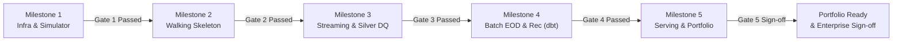

# WORK BREAKDOWN STRUCTURE (WBS) & PROJECT EXECUTION PLAN

> **Hệ thống:** Digital Payments Monitoring & 3-Way Reconciliation Lakehouse Platform  
> **Tài liệu tham chiếu gốc (SSOT):** [`docs/DE_Project2_Master_Handoff.md`](file:///c:/DE-project/digital-payments-lakehouse/docs/DE_Project2_Master_Handoff.md)  
> **Vai trò điều hành:** Senior Technical Project Manager (TPM) & Lead Data Platform Architect  
> **Trạng thái:** Confirmed / Active Execution (Kicking off Phase 9 — Milestone 1)  
> **Phiên bản:** v1.0

---

## 1. EXECUTIVE SUMMARY (TỔNG QUAN ĐIỀU HÀNH)

### 1.1. Mục tiêu Dự án (Project Mission & Objectives)
Dự án **Digital Payments Monitoring & 3-Way Reconciliation Lakehouse** là nền tảng xử lý dữ liệu thanh toán số quy mô lớn mô phỏng môi trường ngân hàng / fintech thực tế. Nền tảng giải quyết hai bài toán kinh doanh độc lập nhưng tương hỗ chặt chẽ:
1. **Near-Real-Time Stream Monitoring:** Giám sát luồng giao dịch trực tiếp từ Payment Gateway với độ trễ cam kết Freshness p95 <= 30s (SLO), phát hiện giao dịch kẹt (`STUCK`), phân tích suy giảm hiệu năng đối tác thanh toán (`Partner Degradation`) kết hợp cơ chế chống rung cảnh báo (`Hysteresis`).
2. **Batch EOD 3-Way Financial Reconciliation:** Đối soát tài chính cuối ngày giữa 3 nguồn độc lập: Sổ cái nội bộ (Internal Wallet Ledger), Tệp đối soát đối tác (Partner Settlement CSV với kịch bản đa phiên bản `v1`/`v2`), và Sao kê ngân hàng (Bank Statement CSV). Tự động phân loại 7 nhóm sai lệch tài chính (Break Types) theo mô hình phân cấp Level 1 -> Level 3.

Nền tảng được thiết kế để bù đắp toàn diện các khoảng trống kỹ thuật nâng cao: **Event-Time Processing & Watermarking, Dual-Table Silver Medallion Architecture, ACID Transactions with Delta Lake, Monotonic State Progression, Circuit Breaker Pattern, Versioned Backfill/Replay, và Cloud-Lakehouse Integration**.

### 1.2. Bối cảnh Học viên & Định hướng Nghề nghiệp (Context & Upskilling Target)
- **Chân dung:** Sinh viên năm 3 ngành Hệ thống Thông tin — Đại học Công nghệ Thông tin (UIT - VNUHCM).
- **Nền tảng sẵn có:** Đã hoàn thành xuất sắc Project 1 (`crypto-coin-pipeline`) với Airflow 3, Async HTTPX, MinIO/S3, DuckDB/MotherDuck, dbt Kimball Star Schema (145 tests), Pydantic v2, Docker CI.
- **Mục tiêu năng lực:** Nâng cấp từ Intern/Fresher lên vững vàng năng lực **Junior Data Engineer (Enterprise-ready)**, tự tin giải trình và vượt qua các vòng phỏng vấn kỹ thuật khắt khe tại các doanh nghiệp công nghệ, ngân hàng và fintech lớn tại Việt Nam (FPT, Viettel, VNPT, KMS, Bosch, Techcombank, VPBank, Momo...) vào đầu năm 2027.

### 1.3. Ràng buộc Dự án (Operational Constraints & Capacity)
- **Tổng quỹ thời gian (Effort Budget):** **200 giờ kỹ thuật** trong thời gian 2–3 tháng (~65–70 ngày làm việc), với kỷ luật làm việc duy trì **~3 giờ/ngày**.
- **Ngân sách tài chính (Hard Budget):** **Dưới 100.000 VND** (Triệt để tận dụng Local-First Docker và Cloud Free Tiers: Databricks Community/Trial + AWS Free Tier).
- **Năng lực phần cứng Workstation:** RAM 32 GB, CPU Intel Xeon W2133 3.6 GHz, ~100 GB SSD trống — hoàn toàn tối ưu để vận hành trơn tru cụm multi-service Docker cục bộ.

### 1.4. Chiến lược Kiến trúc: Dual-Track Topology (Local-First + Cloud Showcase)
Nhằm triệt tiêu rủi ro phát sinh chi phí Cloud ngoài ý muốn, loại bỏ sự phụ thuộc vào đường truyền mạng và đảm bảo tính tái lập 100%:
- **Track 1 — Local-First Core (100% Production-like Execution):** Toàn bộ luồng E2E từ Kafka KRaft, PySpark Structured Streaming, MinIO Delta Lake, Airflow 3, dbt-spark và Metabase chạy hoàn toàn trong `docker compose`. Đạt chuẩn "One-command Reproducibility (`docker compose up -d`)".
- **Track 2 — Cloud Showcase Branch (Databricks + AWS S3):** Đồng bộ dữ liệu lịch sử và batch files lên AWS S3, triển khai job đối soát và phân tích bằng `dbt-databricks` trên Databricks Free Edition để lấy bằng chứng thực chiến (Execution logs, DAG lineage, Spark UI snapshots, Metrics benchmark) đưa vào CV và Portfolio.

---

## 2. EFFORT ALLOCATION MATRIX (MA TRẬN PHÂN BỔ 200 GIỜ)

Ngân sách 200 giờ được cấu trúc chặt chẽ dựa trên phương pháp **Vertical Slicing (Tracer Bullet)**: Xây dựng lát cắt mỏng thông suốt từ nguồn đến đích trước, sau đó phát triển có kiểm soát các cơ chế chuyên sâu (Fault Tolerance, Late Event DLQ, Circuit Breakers, Complex dbt Reconciliation).

### 2.1. Phân bổ Giờ theo 5 Milestones (M1 – M5)

| Milestone | Tên Giai đoạn & Trọng tâm Kỹ thuật | Phân loại Scope | Ngân sách (Hours) | Tỷ trọng (%) |
| :--- | :--- | :---: | :---: | :---: |
| **M1** | **Foundation Infra, Project Layout & Deterministic Simulator (`G0`)**<br>- Setup repo, Docker Compose (Kafka KRaft, MinIO, UI)<br>- Payment Simulator (Pydantic v2, seed-based error injection, Ground Truth `G0`) | `D1 / D2` | **30 h** | **15.0%** |
| **M2** | **The "Walking Skeleton" (Vertical Slice 1: Stream to Bronze)**<br>- Spark Structured Streaming job đọc Kafka `payment.events.raw`<br>- Checkpoint management, Append-only Delta Lake write, Ingestion Partitioning | `D1 / D2` | **25 h** | **12.5%** |
| **M3** | **Stateful Streaming, Dual-Table Silver & Real-time Data Quality**<br>- `foreachBatch` pipeline, Pydantic/PySpark validation, 5% Circuit Breaker<br>- Watermark (2m) deduplication, Late event DLQ (`silver_late_events_dlq`)<br>- Silver Dual-Table: `history` append-only + `current` pre-aggregated MERGE<br>- Dynamic Timer & Stuck transaction detection (5m), Monotonic State Rank<br>- Gold RT Metrics (1m/5m windows) & Hysteresis Partner Degradation | `D1 / D2` | **55 h** | **27.5%** |
| **M4** | **Batch EOD Ingestion, 3-Way Reconciliation (`dbt`) & Cloud Showcase**<br>- Sổ cái CDC (`S2`), Merchant SCD2 (`S3`), Partner CSV v1/v2, Bank CSV (`S4`)<br>- Airflow DAG: Completeness Gate, Grace Period SLA (06:00 AM T+1)<br>- dbt Spark models: Đối soát 3 bên (Level 1->3, 7 Break Types), `run_version`<br>- Databricks Cloud Showcase: Chạy dbt trên Databricks + AWS S3<br>- Đánh giá tự động Precision / Recall đối soát với Ground Truth `G0` | `D1 / D2 / D3` | **55 h** | **27.5%** |
| **M5** | **Serving Dashboards, Scale Benchmark & Portfolio Packaging**<br>- Metabase Serving: Payment Ops Dashboard + Finance Reconciliation Dashboard<br>- Scale Benchmark (1M–5M records) & Compaction/Optimize tuning<br>- Unit & Integration Test Suite (Pytest + dbt test), Failure Injection Drills<br>- Architecture Decision Records (ADRs) & Engineering Portfolio README (English) | `D1 / D2 / D3` | **35 h** | **17.5%** |
| **TỔNG** | **Toàn bộ Dự án (Phase 9 — Build & Review Loop)** | | **200 h** | **100.0%** |

### 2.2. Phân bổ Giờ theo Nhóm Kỹ Năng / Functional Domains

```
   Streaming Engine & Stateful Lakehouse (30.0%) ████████████  60h
   Batch Modeling & Financial Reconciliation (22.5%) █████████   45h
   Data Quality, Circuit Breakers & Contracts (15.0%) ██████    30h
   Testing, Benchmarking & Engineering Docs/ADRs (12.5%) █████     25h
   Infrastructure & Docker Containerization (10.0%) ████      20h
   Orchestration & Pipeline Operations (10.0%) ████      20h
```

| Nhóm Kỹ Năng (Domain) | Công nghệ & Công cụ Chủ đạo | Ngân sách (Hours) | Tỷ trọng (%) | Trọng tâm Phỏng vấn / CV Value |
| :--- | :--- | :---: | :---: | :--- |
| **Streaming Engine & Stateful Lakehouse** | Apache Kafka (KRaft), Apache Spark Structured Streaming, Delta Lake | **60 h** | 30.0% | Event-time processing, Watermarking, Pre-aggregated MERGE, Idempotency, Checkpoints, Small files mitigation. |
| **Batch Modeling & Financial Reconciliation** | dbt (`dbt-spark`, `dbt-databricks`), SQL Window Functions, Star Schema | **45 h** | 22.5% | 3-Way Matching logic, Composite joins, SCD Type 2 point-in-time enrichment, Versioned backfill/replay (`run_version`). |
| **Data Quality, Circuit Breakers & Contracts** | Pydantic v2, PySpark Rules, Delta Table Constraints, DLQ / Quarantine | **30 h** | 15.0% | Multi-layer contract enforcement, 5% batch abortion circuit breaker, Late event DLQ correction, Schema evolution safety. |
| **Testing, Benchmark & Documentation** | Pytest, dbt test, Spark Benchmark, ADRs, Technical Writing | **25 h** | 12.5% | Automated test coverage, Ground truth evaluation (Precision/Recall), Scale benchmark (5M txns), English system documentation. |
| **Infrastructure & Docker Containerization** | Docker, Docker Compose, MinIO S3 API, Kafka UI, Local Networking | **20 h** | 10.0% | Dual-listener Kafka setup, S3 bucket policy automation, resource isolation, zero-cost reproducible environment. |
| **Orchestration & Pipeline Operations** | Apache Airflow 3, DAGs, TaskFlow API, Airflow Sensors, SLAs | **20 h** | 10.0% | Completeness Gate logic, T+1 01:00 AM trigger, Grace Period SLA handling, File versioning & sensor timeouts. |
| **TỔNG CỘNG** | | **200 h** | **100.0%** | |

---

## 3. WBS INDEX & DOCUMENT DIRECTORY (MỤC LỤC TÀI LIỆU CHI TIẾT)

Hệ thống tài liệu WBS được tổ chức theo chuẩn kỹ thuật module hóa. Mỗi file tương ứng với một Milestone hoặc Quy chuẩn kỹ thuật độc lập. Truy cập chi tiết qua các liên kết bên dưới:

- [`00_wbs_dictionary_standard.md`](file:///c:/DE-project/digital-payments-lakehouse/docs/wbs/00_wbs_dictionary_standard.md): **WBS Task Specification Schema, Global Invariants & Global Definition of Done** — Mẫu đặc tả task kỹ thuật, các nguyên tắc bất biến về tiền tệ, mô hình thời gian, kiến trúc Medallion và tiêu chuẩn nghiệm thu toàn cục.
- [`milestone_1_foundation_and_simulator.md`](file:///c:/DE-project/digital-payments-lakehouse/docs/wbs/milestone_1_foundation_and_simulator.md): **Milestone 1 — Foundation Infra, Configuration & Deterministic Simulator (`G0`)** — Thiết lập hạ tầng Docker, Kafka KRaft dual-listener, MinIO buckets, simulator Pydantic với seed cố định và xuất Ground Truth `G0`.
- [`milestone_2_walking_skeleton.md`](file:///c:/DE-project/digital-payments-lakehouse/docs/wbs/milestone_2_walking_skeleton.md): **Milestone 2 — The "Walking Skeleton" (Vertical Slice 1: Kafka -> Spark -> Delta Bronze)** — Dựng pipeline streaming sơ khởi end-to-end, kiểm chứng checkpoint, schema Bronze và ghi Append-only an toàn.
- [`milestone_3_stateful_streaming_silver_dq.md`](file:///c:/DE-project/digital-payments-lakehouse/docs/wbs/milestone_3_stateful_streaming_silver_dq.md): **Milestone 3 — Stateful Streaming, Dual-Table Silver & Real-time Data Quality** — Triển khai `foreachBatch`, Watermark deduplication (2m), Dynamic Timer & Stuck detection (5m), Silver Dual-Table (`history` + `current`), Circuit Breaker (5%), Quarantine/DLQ và Gold RT Metrics (Hysteresis).
- [`milestone_4_batch_reconciliation_cloud.md`](file:///c:/DE-project/digital-payments-lakehouse/docs/wbs/milestone_4_batch_reconciliation_cloud.md): **Milestone 4 — Batch EOD Ingestion, 3-Way Reconciliation (`dbt`) & Cloud Showcase** — Airflow Completeness Gate, ingest S2/S3/S4, dbt 3-Way Reconciliation (Level 1-3, 7 Break Types), Cloud Databricks execution và Ground Truth validation.
- [`milestone_5_serving_benchmark_portfolio.md`](file:///c:/DE-project/digital-payments-lakehouse/docs/wbs/milestone_5_serving_benchmark_portfolio.md): **Milestone 5 — Serving Dashboards, Scale Benchmark & Portfolio Packaging** — Dựng 2 Dashboards Metabase (Ops & Finance), Benchmark hiệu năng 1M–5M records, kiểm thử phục hồi lỗi (Fault injection drills), hoàn thiện ADRs và Portfolio README tiếng Anh.
- [`dependency_graph_and_critical_path.md`](file:///c:/DE-project/digital-payments-lakehouse/docs/wbs/dependency_graph_and_critical_path.md): **Dependency Graph & Critical Path Analysis (CPM)** — Sơ đồ quan hệ phụ thuộc giữa 100% các task, xác định đường găng và kế hoạch dự phòng rủi ro chậm trễ.

---

## 4. MILESTONE GOVERNANCE & QUALITY GATES (QUY TRÌNH CHỐT SỔ & TIÊU CHÍ CHUYỂN PHA)

Dự án áp dụng cơ chế **Quality Gates** nghiêm ngặt. Để được phép chuyển giao từ Milestone hiện tại sang Milestone tiếp theo, toàn bộ tiêu chí tại Gate tương ứng phải được kiểm chứng bằng log thực tế, test script tự động và bằng chứng khách quan (Evidence Artifacts).



### Gate 1: Milestone 1 -> Milestone 2 (Foundation & Simulator Gate)
- **Evidence Storage Directory:** `docs/evidence/m1/gate_1_signoff/`
- **Tiêu chí Kỹ thuật:**
  1. `docker-compose.yml` khởi động sạch 100% các services (`kafka`, `kafka-ui`, `minio`, `mc-init`), các port map chính xác, không xung đột. (Artifact: `logs/docker_compose_ps.log`, `screenshots/kafka_ui_healthy.png`, `screenshots/minio_buckets.png`).
  2. Kafka UI kết nối thành công tới Kafka KRaft qua listener nội bộ `kafka:29092`; script test từ máy host gửi/nhận message được qua `localhost:9092`.
  3. MinIO tự động tạo bucket `lakehouse` với đầy đủ prefix phân tầng (`bronze/`, `silver/`, `gold/`, `checkpoints/`).
  4. Simulator chạy thành công với `--seed 20260930`, sinh đúng lifecycle giao dịch (Rank 1 -> 6), tiêm chính xác các loại lỗi (duplicate, late, stuck, poison, amount mismatch) và kết xuất file Ground Truth `data/ground_truth/G0_events_seed_20260930.jsonl`. (Artifact: `logs/seed_parity_hash.log`, `data_samples/g0_sample_100_rows.jsonl`).
  5. 100% schema và config được validate qua Pydantic v2 models với type annotations đầy đủ. (Artifact: `logs/pytest_m1_passed.log`).

### Gate 2: Milestone 2 -> Milestone 3 (Walking Skeleton Gate)
- **Evidence Storage Directory:** `docs/evidence/m2/gate_2_signoff/`
- **Tiêu chí Kỹ thuật:**
  1. Spark Structured Streaming job đọc trực tiếp từ topic `payment.events.raw` và ghi Append-only xuống bảng Delta `bronze_payment_events` trên MinIO. (Artifact: `logs/spark_streaming_bronze_exec.log`, `screenshots/spark_ui_streaming_tab.png`).
  2. Quản lý checkpoint streaming độc lập trên MinIO; kiểm tra khả năng phục hồi (Recovery Test): Giết container Spark, gửi thêm 500 events, khởi động lại Spark -> Job tiếp tục đọc đúng offset chưa commit, không mất mát dữ liệu và không ghi trùng offset. (Artifact: `logs/crash_recovery_drill_offsets.log`).
  3. Bảng Delta Bronze phân vùng chuẩn theo `ingestion_date`; truy vấn `DESCRIBE DETAIL bronze_payment_events` và `DESCRIBE HISTORY bronze_payment_events` xác nhận định dạng Delta Lake chuẩn xác. (Artifact: `data_samples/delta_bronze_history.txt`).

### Gate 3: Milestone 3 -> Milestone 4 (Stateful Streaming & Silver DQ Gate)
- **Evidence Storage Directory:** `docs/evidence/m3/gate_3_signoff/`
- **Tiêu chí Kỹ thuật:**
  1. Luồng micro-batch `foreachBatch` xử lý đồng bộ và an toàn:
     - **Circuit Breaker (5%):** Tiêm kịch bản lỗi > 5% poison records -> Job chủ động abort ngay lập tức, ghi log cảnh báo mức `CRITICAL`. (Artifact: `logs/circuit_breaker_abort_event.log`).
     - **Quarantine:** Tách các bản ghi lỗi kỹ thuật (khi tỷ lệ <= 5%) vào `silver_quarantine_events`. (Artifact: `data_samples/quarantine_sample.jsonl`).
     - **Watermark & DLQ:** Các bản ghi đến trễ > 2 phút bị loại khỏi luồng streaming chính và chuyển vào `silver_late_events_dlq`. (Artifact: `data_samples/late_dlq_sample.jsonl`).
  2. **Silver Dual-Table Integrity:**
     - `silver_payment_events_history` lưu toàn bộ state transitions hợp lệ (append-only).
     - `silver_transactions_current` đạt tính đơn nhất tuyệt đối (duy nhất 1 dòng / `transaction_id`), không xảy ra lỗi multiple-row merge conflict; cập nhật đúng Monotonic State Rank (không bao giờ thụt lùi trạng thái). (Artifact: `logs/silver_preaggregated_merge_history.log`, `data_samples/silver_current_sample.jsonl`).
  3. **Stuck Detection & Conflicts:**
     - Giao dịch ở trạng thái `PROCESSING` quá 5 phút được gắn cờ `operational_status = STUCK`; khi nhận terminal event đến muộn, cờ được gỡ về `NORMAL` nhưng giữ nguyên `was_ever_stuck = TRUE`. (Artifact: `logs/stuck_transaction_timer_audit.log`).
     - Bản ghi Terminal mâu thuẫn (nhận `FAILED` sau `COMPLETED`) bị chặn và chuyển sang `silver_lifecycle_exceptions`.
  4. **Performance & Freshness:** Luồng đạt Freshness SLO p95 <= 30s với tải baseline 5–50 events/s; bảng `gold_rt_channel_metrics` phản ánh đúng cơ chế Hysteresis (yêu cầu 2 chu kỳ liên tiếp >= 95% để gỡ cảnh báo suy giảm). (Artifact: `logs/hysteresis_recovery_audit.log`, `screenshots/gold_rt_metrics_query.png`).

### Gate 4: Milestone 4 -> Milestone 5 (Batch EOD & Reconciliation Gate)
- **Evidence Storage Directory:** `docs/evidence/m4/gate_4_signoff/`
- **Tiêu chí Kỹ thuật:**
  1. Airflow DAG orchestrate hoàn chỉnh luồng EOD:
     - **Completeness Gate:** Kiểm tra đủ 3 nguồn (Ledger, Partner CSV, Bank CSV) lúc 01:00 AM T+1. Nếu thiếu nguồn, tự động chờ đến 06:00 AM (Grace Period SLA); quá hạn vẫn thiếu thì phát cảnh báo `CRITICAL_SLA_BREACH` và đánh dấu run là `INCOMPLETE`. (Artifact: `screenshots/airflow_dag_completeness_gate.png`, `logs/airflow_sla_timeout.log`).
     - **Version-aware CSV Ingestion:** Ingest đúng file phiên bản hợp lệ mới nhất (`v2` thay thế `v1`), lưu append-only toàn bộ file history.
  2. **dbt 3-Way Reconciliation Models:**
     - Phân loại chính xác 100% các giao dịch vào 7 nhóm Break Types. (Artifact: `data_samples/dbt_reconciliation_details_sample.csv`).
     - Cơ chế `run_version` hoạt động lũy đẳng: Rerun hoặc backfill sinh `run_version` mới, không xóa đè dữ liệu cũ. View báo cáo đọc phiên bản mới nhất.
  3. **Ground Truth Validation (`G0`):** Đối chiếu kết quả đối soát tự động với `G0` đạt **Precision >= 99.5%** và **Recall >= 99.5%**. (Artifact: `logs/g0_reconciliation_eval_report.txt`, `data_samples/g0_confusion_matrix.json`).
  4. **Cloud Showcase Verification:** Mô hình dbt chạy thành công trên Databricks Free Edition đọc dữ liệu từ AWS S3, cung cấp đầy đủ run log và DAG lineage. (Artifact: `screenshots/databricks_job_run_lineage.png`, `logs/dbt_databricks_run.log`).

### Gate 5: Milestone 5 Done -> Project Sign-off (Enterprise Portfolio Gate)
- **Evidence Storage Directory:** `docs/evidence/m5/gate_5_signoff/`
- **Tiêu chí Kỹ thuật & Nghiệm thu:**
  1. **Serving Dashboards:** Metabase kết nối tới tầng Gold, dựng hoàn chỉnh 2 Dashboards:
     - Dashboard 1: Payment Operations Near-Real-Time (Freshness, TPS, Success rate by channel, Stuck transactions list, Degradation alerts). (Artifact: `screenshots/metabase_payment_ops_live.png`).
     - Dashboard 2: Finance & EOD Reconciliation (Run status, Total variance amount, Break distribution chart, Drill-down to individual transactions). (Artifact: `screenshots/metabase_finance_reconciliation_live.png`).
  2. **Scale Benchmark:** Pipeline vượt qua bài kiểm tra chịu tải 1M giao dịch; có số liệu đo lường dung lượng Delta Lake trước/sau `OPTIMIZE` và `VACUUM`. (Artifact: `logs/benchmark_1m_throughput.log`, `data_samples/storage_optimization_metrics.txt`).
  3. **Automated Test Coverage:** Bộ test Pytest (Unit/Integration) và dbt test (schema/business logic) pass 100%. (Artifact: `logs/final_pytest_coverage_report.log`, `logs/final_dbt_test_report.log`).
  4. **Portfolio Deliverables:**
     - Toàn bộ Architecture Decision Records (ADRs) từ C01 đến C24 được hoàn thiện.
     - File `README.md` chính của repository viết bằng tiếng Anh chuẩn kỹ sư quốc tế, có kiến trúc trực quan, video/GIF demo và hướng dẫn "One-command Reproducibility".

---

## 5. WORKING AGREEMENT & ĐIỀU KIỆN TIÊN QUYẾT CHO HỌC VIÊN

1. **Nguyên tắc "Code-First, Evidence-Driven":** Mọi task kỹ thuật chỉ được xem là hoàn thành khi có code, log thực thi thực tế và bằng chứng test đạt (Evidence). Không chấp nhận "nói suông" hoặc code chưa chạy thử nghiệm.
2. **Kỷ luật Git & Commit:** Mỗi task WBS tương ứng với một Git branch hoặc atomic commit message rõ ràng: `feat(wbs-mX-tYY): <nội dung tóm tắt>`.
3. **Quản trị Rủi ro:** Nếu một task bị kẹt quá 2 session làm việc (> 6 giờ), lập tức kích hoạt bước hội chẩn với Mentor để tháo gỡ blocker hoặc điều chỉnh giải pháp kỹ thuật, không để trễ hạn toàn bộ Milestone.
4. **Kỷ luật Lưu vết Bằng chứng (`docs/evidence/`):** Mỗi khi hoàn thành một Task hoặc đóng một Quality Gate, học viên bắt buộc phải lưu file log thực thi, ảnh chụp giao diện (UI screenshots) và trích xuất mẫu dữ liệu vào đúng thư mục tương ứng `docs/evidence/m{X}/wbs-m{X}-t{YY}/` hoặc `docs/evidence/m{X}/gate_{X}_signoff/` theo quy chuẩn tại [`docs/wbs/00_wbs_dictionary_standard.md`](file:///c:/DE-project/digital-payments-lakehouse/docs/wbs/00_wbs_dictionary_standard.md). Các bằng chứng này là tài sản cốt lõi phục vụ viết Portfolio README và bảo vệ trước nhà tuyển dụng.

