# MASTER DEPENDENCY GRAPH & CRITICAL PATH ANALYSIS (CPM)

> **Hệ thống:** Digital Payments Monitoring & 3-Way Reconciliation Lakehouse Platform  
> **Tài liệu tham chiếu gốc (SSOT):** [`docs/DE_Project2_Master_Handoff.md`](file:///c:/DE-project/digital-payments-lakehouse/docs/DE_Project2_Master_Handoff.md)  
> **Quy chuẩn kỹ thuật WBS:** [`docs/wbs/00_wbs_dictionary_standard.md`](file:///c:/DE-project/digital-payments-lakehouse/docs/wbs/00_wbs_dictionary_standard.md)  
> **Tài liệu điều phối tổng thể:** [`docs/wbs/README.md`](file:///c:/DE-project/digital-payments-lakehouse/docs/wbs/README.md)  
> **Vai trò điều hành:** Senior Technical Project Manager (TPM) & Lead Data Platform Architect  
> **Ngân sách Toàn dự án:** **200 giờ Baseline** (Ngân sách Điều chỉnh: **209 giờ Kỹ thuật**)  
> **Mục tiêu tài liệu:** Cung cấp cái nhìn toàn cảnh về mạng lưới phụ thuộc giữa 100% các gói việc (Work Packages) và các nhiệm vụ then chốt (Key Tasks), xác định chính xác Đường găng (Critical Path Method - CPM), các luồng công việc song song (Parallel Tracks) và chiến lược quản trị rủi ro tiến độ.

---

## 1. MASTER DEPENDENCY NETWORK GRAPH (SƠ ĐỒ MẠNG PHỤ THUỘC TỔNG THỂ)

Sơ đồ dưới đây thể hiện toàn bộ quan hệ phụ thuộc có hướng giữa 5 Milestones, 14 Work Packages và các nhiệm vụ kỹ thuật từ ngày khởi động dự án đến ngày nghiệm thu cuối cùng:

```mermaid
flowchart TD
    %% ==========================================
    %% MILESTONE 1: FOUNDATION & SIMULATOR
    %% ==========================================
    subgraph M1["MILESTONE 1: Foundation Infra & Deterministic Simulator (30h)"]
        direction TB
        M1_T01["[WBS-M1-T01]<br>Docker Compose & Services Hardening (4h)"]
        M1_T02["[WBS-M1-T02]<br>Layout, Virtualenv & Config Engine (4h)"]
        M1_T03["[WBS-M1-T03]<br>Pydantic v2 Contracts & Invariants (4h)"]
        M1_T04["[WBS-M1-T04]<br>Payment State Machine Rank 1->6 (6h)"]
        M1_T05["[WBS-M1-T05]<br>Deterministic Generator & Fault Injector (5h)"]
        M1_T06["[WBS-M1-T06]<br>Ground Truth G0 Exporter (3h)"]
        M1_T07["[WBS-M1-T07]<br>Kafka Producer with Rate Throttling (2h)"]
        M1_T08["[WBS-M1-T08]<br>E2E Verification & Gate 1 Audit (2h)"]

        M1_T01 --> M1_T02 --> M1_T03 --> M1_T04 --> M1_T05
        M1_T05 --> M1_T06
        M1_T05 --> M1_T07
        M1_T06 --> M1_T08
        M1_T07 --> M1_T08
    end

    %% GATE 1
    M1_T08 ==>|Gate 1 Passed| GATE1{"QUALITY GATE 1<br>(Infra & G0 Verified)"}

    %% ==========================================
    %% MILESTONE 2: WALKING SKELETON
    %% ==========================================
    subgraph M2["MILESTONE 2: Walking Skeleton - Stream to Bronze (25h)"]
        direction TB
        M2_T01["[WBS-M2-T01]<br>Spark & S3A/Delta Extensions Container (3h)"]
        M2_T02["[WBS-M2-T02]<br>Spark Session Factory & S3A Config (3h)"]
        M2_T03["[WBS-M2-T03]<br>Kafka Structured Streaming Consumer (3h)"]
        M2_T04["[WBS-M2-T04]<br>Raw Payload Preservation & Metadata (3h)"]
        M2_T05["[WBS-M2-T05]<br>Delta Bronze Sink & Checkpointing (5h)"]
        M2_T06["[WBS-M2-T06]<br>Delta Table Inspection & Schema Enforcement (3h)"]
        M2_T07["[WBS-M2-T07]<br>Crash Recovery Drill: C07 Zero Loss (3h)"]
        M2_T08["[WBS-M2-T08]<br>Ingestion Test Suite & Gate 2 Audit (2h)"]

        M2_T01 --> M2_T02 --> M2_T03 --> M2_T04 --> M2_T05
        M2_T05 --> M2_T06
        M2_T05 --> M2_T07
        M2_T06 --> M2_T08
        M2_T07 --> M2_T08
    end

    GATE1 ==> M2_T01
    M2_T08 ==>|Gate 2 Passed| GATE2{"QUALITY GATE 2<br>(Bronze Streaming Stable)"}

    %% ==========================================
    %% MILESTONE 3: STATEFUL STREAMING & SILVER DQ
    %% ==========================================
    subgraph M3["MILESTONE 3: Stateful Streaming & Silver DQ (58h)"]
        direction TB
        M3_T01["[WBS-M3-T01]<br>foreachBatch Dispatcher Framework (4h)"]
        M3_T02["[WBS-M3-T02]<br>Quarantine Routing & 5% Circuit Breaker (5h)"]
        M3_T03["[WBS-M3-T03]<br>Watermark 2m Deduplication & Late DLQ (5h)"]
        M3_T04["[WBS-M3-T04]<br>Append-Only History Table Sink (4h)"]
        M3_T05["[WBS-M3-T05]<br>Pre-aggregated Collapse & Delta MERGE (7h)"]
        M3_T06["[WBS-M3-T06]<br>Dynamic Timer & 5m Stuck Detector (4h)"]
        M3_T07["[WBS-M3-T07]<br>Terminal Conflict & Exception Branch (3h)"]
        M3_T08["[WBS-M3-T08]<br>Multi-Window RT Metrics 1m & 5m (5h)"]
        M3_T09["[WBS-M3-T09]<br>Partner Degradation & Hysteresis (5h)"]
        M3_T10["[WBS-M3-T10]<br>Delta Gold Sink & RT Serving View (4h)"]
        M3_T11["[WBS-M3-T11]<br>Real-Time Failure Drills (6h)"]
        M3_T12["[WBS-M3-T12]<br>M3 E2E Test Suite & Gate 3 Audit (6h)"]

        M3_T01 --> M3_T02 --> M3_T03 --> M3_T04 --> M3_T05
        M3_T05 --> M3_T06
        M3_T05 --> M3_T07
        M3_T05 --> M3_T08 --> M3_T09 --> M3_T10
        M3_T06 --> M3_T11
        M3_T07 --> M3_T11
        M3_T10 --> M3_T11
        M3_T11 --> M3_T12
    end

    GATE2 ==> M3_T01

    %% ==========================================
    %% MILESTONE 4: BATCH EOD & 3-WAY RECONCILIATION
    %% ==========================================
    subgraph M4["MILESTONE 4: Batch EOD & 3-Way Reconciliation (59h)"]
        direction TB
        M4_T01["[WBS-M4-T01]<br>S2 Wallet Ledger CDC Generator (4h)"]
        M4_T02["[WBS-M4-T02]<br>S3 Merchant Master SCD Type 2 (5h)"]
        M4_T03["[WBS-M4-T03]<br>S4 Partner CSV & Multi-Version Mock (5h)"]
        M4_T04["[WBS-M4-T04]<br>Airflow Stack & S3/Spark/dbt Setup (4h)"]
        M4_T05["[WBS-M4-T05]<br>Completeness Gate & 06:00 AM SLA (6h)"]
        M4_T06["[WBS-M4-T06]<br>Version-Aware CSV Manifest DAG (5h)"]
        M4_T07["[WBS-M4-T07]<br>dbt Layout, Contracts & Staging (4h)"]
        M4_T08["[WBS-M4-T08]<br>3-Way Matching Engine Level 1 & 2 (6h)"]
        M4_T09["[WBS-M4-T09]<br>7 Break Types & run_version Marts (6h)"]
        M4_T10["[WBS-M4-T10]<br>Databricks Cloud Showcase & S3 (5h)"]
        M4_T11["[WBS-M4-T11]<br>G0 Precision/Recall Evaluator (5h)"]
        M4_T12["[WBS-M4-T12]<br>M4 E2E Test Suite & Gate 4 Audit (4h)"]

        M4_T01 --> M4_T02
        M4_T01 --> M4_T03
        M4_T04 --> M4_T05
        M4_T03 --> M4_T05
        M4_T05 --> M4_T06 --> M4_T07 --> M4_T08 --> M4_T09
        M4_T09 --> M4_T10
        M4_T09 --> M4_T11
        M4_T10 --> M4_T12
        M4_T11 --> M4_T12
    end

    %% M4 can start data generators after Gate 1, but dbt models need Silver from Gate 3
    GATE1 -.->|Parallel Data Mocking| M4_T01
    GATE2 -.->|Airflow Infra Setup| M4_T04
    M3_T12 ==>|Gate 3 Passed| GATE3{"QUALITY GATE 3<br>(Silver & RT Gold Healthy)"}
    GATE3 ==> M4_T07

    M4_T12 ==>|Gate 4 Passed| GATE4{"QUALITY GATE 4<br>(3-Way Rec & G0 >= 99.5%)"}

    %% ==========================================
    %% MILESTONE 5: SERVING & PORTFOLIO
    %% ==========================================
    subgraph M5["MILESTONE 5: Serving, Benchmark & Portfolio (37h)"]
        direction TB
        M5_T01["[WBS-M5-T01]<br>Metabase Setup & Delta Handshake (3h)"]
        M5_T02["[WBS-M5-T02]<br>Dashboard 1: Payment Ops Near-RT (3.5h)"]
        M5_T03["[WBS-M5-T03]<br>Dashboard 2: Finance EOD Reconciliation (3.5h)"]
        M5_T04["[WBS-M5-T04]<br>1M-5M Stress Test Benchmark (5h)"]
        M5_T05["[WBS-M5-T05]<br>Delta Storage Tuning: OPTIMIZE & Z-ORDER (5h)"]
        M5_T06["[WBS-M5-T06]<br>ADR Documents in English: C02, C15, C18 (4h)"]
        M5_T07["[WBS-M5-T07]<br>Comprehensive Test Hardening (4h)"]
        M5_T08["[WBS-M5-T08]<br>Enterprise English README & 1-Command (5h)"]
        M5_T09["[WBS-M5-T09]<br>Final Sign-Off & Interview Defense Kit (4h)"]

        M5_T01 --> M5_T02
        M5_T01 --> M5_T03
        M5_T02 --> M5_T04
        M5_T03 --> M5_T04
        M5_T04 --> M5_T05
        M5_T05 --> M5_T07
        M5_T06 --> M5_T08
        M5_T07 --> M5_T08
        M5_T08 --> M5_T09
    end

    GATE4 ==> M5_T01
    GATE4 -.->|ADR Drafting Parallel| M5_T06
    M5_T09 ==>|Final Project Sign-off| PROJECT_DONE(["PORTFOLIO READY<br>& ENTERPRISE LAUNCH SIGN-OFF"])

    %% Style definitions for Critical Path
    classDef critical stroke:#ff0000,stroke-width:3px,fill:#ffe6e6,color:#990000;
    class M1_T01,M1_T02,M1_T03,M1_T04,M1_T05,M1_T06,M1_T08,GATE1,M2_T01,M2_T02,M2_T03,M2_T04,M2_T05,M2_T07,M2_T08,GATE2,M3_T01,M3_T02,M3_T03,M3_T04,M3_T05,M3_T08,M3_T09,M3_T10,M3_T11,M3_T12,GATE3,M4_T07,M4_T08,M4_T09,M4_T11,M4_T12,GATE4,M5_T01,M5_T02,M5_T04,M5_T05,M5_T07,M5_T08,M5_T09,PROJECT_DONE critical;
```



---

## 2. PHÂN TÍCH ĐƯỜNG GĂNG (CRITICAL PATH METHOD - CPM)

Đường găng (**Critical Path**) là chuỗi các nhiệm vụ có thời gian phụ thuộc tuần tự dài nhất, trong đó **Độ trễ toàn phần (Total Float / Slack) bằng 0**. Bất kỳ một sự chậm trễ nào trên các task thuộc đường găng sẽ trực tiếp làm trễ ngày hoàn thành toàn bộ dự án.

### 2.1. Chuỗi Nhiệm vụ trên Đường Găng (Critical Sequence)

```
[M1-T01] -> [M1-T02] -> [M1-T03] -> [M1-T04] -> [M1-T05] -> [M1-T06] -> [M1-T08] (28h)
    │
[GATE 1]
    ▼
[M2-T01] -> [M2-T02] -> [M2-T03] -> [M2-T04] -> [M2-T05] -> [M2-T07] -> [M2-T08] (22h)
    │
[GATE 2]
    ▼
[M3-T01] -> [M3-T02] -> [M3-T03] -> [M3-T04] -> [M3-T05] -> [M3-T08] -> [M3-T09] -> [M3-T10] -> [M3-T11] -> [M3-T12] (51h)
    │
[GATE 3]
    ▼
[M4-T07] -> [M4-T08] -> [M4-T09] -> [M4-T11] -> [M4-T12] (25h)
    │
[GATE 4]
    ▼
[M5-T01] -> [M5-T02/03] -> [M5-T04] -> [M5-T05] -> [M5-T07] -> [M5-T08] -> [M5-T09] (29.5h)
    │
[FINAL PROJECT SIGN-OFF]
```

### 2.2. Bảng Phân tích Tham số Thời gian (CPM Schedule Table)

*Đơn vị tính: Giờ làm việc kỹ thuật (Hours).*

| WBS Code | Tên Task Kỹ thuật | Thời lượng | Sớm nhất (ES) | Sớm nhất (EF) | Muộn nhất (LS) | Muộn nhất (LF) | Độ trễ (Float) | Trạng thái |
| :--- | :--- | :---: | :---: | :---: | :---: | :---: | :---: | :---: |
| `WBS-M1-T01` | Docker Compose Stack Hardening | 4.0 | 0.0 | 4.0 | 0.0 | 4.0 | **0.0** | **CRITICAL** |
| `WBS-M1-T02` | Layout, Virtualenv & Config Engine | 4.0 | 4.0 | 8.0 | 4.0 | 8.0 | **0.0** | **CRITICAL** |
| `WBS-M1-T03` | Pydantic v2 Contracts & Invariants | 4.0 | 8.0 | 12.0 | 8.0 | 12.0 | **0.0** | **CRITICAL** |
| `WBS-M1-T04` | Payment State Machine Rank 1->6 | 6.0 | 12.0 | 18.0 | 12.0 | 18.0 | **0.0** | **CRITICAL** |
| `WBS-M1-T05` | Deterministic Generator & Fault Injector | 5.0 | 18.0 | 23.0 | 18.0 | 23.0 | **0.0** | **CRITICAL** |
| `WBS-M1-T06` | Ground Truth G0 Exporter | 3.0 | 23.0 | 26.0 | 23.0 | 26.0 | **0.0** | **CRITICAL** |
| `WBS-M1-T07` | Resilient Kafka Producer | 2.0 | 23.0 | 25.0 | 24.0 | 26.0 | 1.0 | Non-critical |
| `WBS-M1-T08` | E2E Verification & Gate 1 Audit | 2.0 | 26.0 | 28.0 | 26.0 | 28.0 | **0.0** | **CRITICAL** |
| **GATE 1** | **Foundation & Simulator Sign-Off** | — | **28.0** | **28.0** | **28.0** | **28.0** | **0.0** | **MILESTONE** |
| `WBS-M2-T01` | PySpark Container & S3A Extensions | 3.0 | 28.0 | 31.0 | 28.0 | 31.0 | **0.0** | **CRITICAL** |
| `WBS-M2-T02` | Spark Session Factory & MinIO S3A | 3.0 | 31.0 | 34.0 | 31.0 | 34.0 | **0.0** | **CRITICAL** |
| `WBS-M2-T03` | Kafka Structured Streaming Consumer | 3.0 | 34.0 | 37.0 | 34.0 | 37.0 | **0.0** | **CRITICAL** |
| `WBS-M2-T04` | Raw Payload Preservation & Schema | 3.0 | 37.0 | 40.0 | 37.0 | 40.0 | **0.0** | **CRITICAL** |
| `WBS-M2-T05` | Delta Bronze Sink & Checkpointing | 5.0 | 40.0 | 45.0 | 40.0 | 45.0 | **0.0** | **CRITICAL** |
| `WBS-M2-T06` | Delta Table Inspection & Schema Audit | 3.0 | 45.0 | 48.0 | 45.0 | 48.0 | 0.0 | Near-critical |
| `WBS-M2-T07` | Crash & Outage Recovery Drill (C07) | 3.0 | 45.0 | 48.0 | 45.0 | 48.0 | **0.0** | **CRITICAL** |
| `WBS-M2-T08` | Ingestion Test Suite & Gate 2 Audit | 2.0 | 48.0 | 50.0 | 48.0 | 50.0 | **0.0** | **CRITICAL** |
| **GATE 2** | **Walking Skeleton Sign-Off** | — | **50.0** | **50.0** | **50.0** | **50.0** | **0.0** | **MILESTONE** |
| `WBS-M3-T01` | foreachBatch Dispatcher Framework | 4.0 | 50.0 | 54.0 | 50.0 | 54.0 | **0.0** | **CRITICAL** |
| `WBS-M3-T02` | Quarantine Routing & 5% Circuit Breaker | 5.0 | 54.0 | 59.0 | 54.0 | 59.0 | **0.0** | **CRITICAL** |
| `WBS-M3-T03` | Watermark Deduplication & Late DLQ | 5.0 | 59.0 | 64.0 | 59.0 | 64.0 | **0.0** | **CRITICAL** |
| `WBS-M3-T04` | Append-Only History Table Sink | 4.0 | 64.0 | 68.0 | 64.0 | 68.0 | **0.0** | **CRITICAL** |
| `WBS-M3-T05` | Pre-aggregated Collapse & Delta MERGE | 7.0 | 68.0 | 75.0 | 68.0 | 75.0 | **0.0** | **CRITICAL** |
| `WBS-M3-T06` | Dynamic Timer & 5m Stuck Detector | 4.0 | 75.0 | 79.0 | 76.0 | 80.0 | 1.0 | Non-critical |
| `WBS-M3-T07` | Terminal Conflict & Exception Branch | 3.0 | 75.0 | 78.0 | 77.0 | 80.0 | 2.0 | Non-critical |
| `WBS-M3-T08` | Multi-Window RT Metrics (1m & 5m) | 5.0 | 75.0 | 80.0 | 75.0 | 80.0 | **0.0** | **CRITICAL** |
| `WBS-M3-T09` | Partner Degradation & Hysteresis | 5.0 | 80.0 | 85.0 | 80.0 | 85.0 | **0.0** | **CRITICAL** |
| `WBS-M3-T10` | Delta Gold Sink & RT Serving View | 4.0 | 85.0 | 89.0 | 85.0 | 89.0 | **0.0** | **CRITICAL** |
| `WBS-M3-T11` | Automated Real-Time Failure Drills | 6.0 | 89.0 | 95.0 | 89.0 | 95.0 | **0.0** | **CRITICAL** |
| `WBS-M3-T12` | M3 E2E Test Suite & Gate 3 Audit | 6.0 | 95.0 | 101.0 | 95.0 | 101.0 | **0.0** | **CRITICAL** |
| **GATE 3** | **Stateful Streaming & Silver DQ Sign-Off** | — | **101.0** | **101.0** | **101.0** | **101.0** | **0.0** | **MILESTONE** |
| `WBS-M4-T01` | S2 Wallet Ledger CDC Generator | 4.0 | 28.0* | 32.0 | 77.0 | 81.0 | 49.0 | Parallel Track |
| `WBS-M4-T02` | S3 Merchant Master SCD Type 2 | 5.0 | 32.0 | 37.0 | 81.0 | 86.0 | 49.0 | Parallel Track |
| `WBS-M4-T03` | S4 Partner CSV & Multi-Version Mock | 5.0 | 32.0 | 37.0 | 81.0 | 86.0 | 49.0 | Parallel Track |
| `WBS-M4-T04` | Airflow Stack & Providers Setup | 4.0 | 50.0* | 54.0 | 82.0 | 86.0 | 32.0 | Parallel Track |
| `WBS-M4-T05` | Completeness Gate & 06:00 AM SLA | 6.0 | 54.0 | 60.0 | 86.0 | 92.0 | 32.0 | Parallel Track |
| `WBS-M4-T06` | Version-Aware CSV Manifest DAG | 5.0 | 60.0 | 65.0 | 96.0 | 101.0 | 36.0 | Parallel Track |
| `WBS-M4-T07` | dbt Layout, Contracts & Staging | 4.0 | 101.0 | 105.0 | 101.0 | 105.0 | **0.0** | **CRITICAL** |
| `WBS-M4-T08` | 3-Way Matching Engine Level 1 & 2 | 6.0 | 105.0 | 111.0 | 105.0 | 111.0 | **0.0** | **CRITICAL** |
| `WBS-M4-T09` | 7 Break Types & run_version Marts | 6.0 | 111.0 | 117.0 | 111.0 | 117.0 | **0.0** | **CRITICAL** |
| `WBS-M4-T10` | Databricks Cloud Showcase & S3 | 5.0 | 117.0 | 122.0 | 117.0 | 122.0 | 0.0 | Near-critical |
| `WBS-M4-T11` | G0 Precision / Recall Evaluator | 5.0 | 117.0 | 122.0 | 117.0 | 122.0 | **0.0** | **CRITICAL** |
| `WBS-M4-T12` | M4 E2E Test Suite & Gate 4 Audit | 4.0 | 122.0 | 126.0 | 122.0 | 126.0 | **0.0** | **CRITICAL** |
| **GATE 4** | **3-Way Reconciliation & Cloud Sign-Off**| — | **126.0** | **126.0** | **126.0** | **126.0** | **0.0** | **MILESTONE** |
| `WBS-M5-T01` | Metabase Deployment & Serving Handshake| 3.0 | 126.0 | 129.0 | 126.0 | 129.0 | **0.0** | **CRITICAL** |
| `WBS-M5-T02` | Dashboard 1: Payment Operations Near-RT | 3.5 | 129.0 | 132.5 | 129.0 | 132.5 | **0.0** | **CRITICAL** |
| `WBS-M5-T03` | Dashboard 2: Finance EOD Reconciliation| 3.5 | 129.0 | 132.5 | 129.0 | 132.5 | 0.0 | Near-critical |
| `WBS-M5-T04` | 1M-5M Stress Test Benchmark | 5.0 | 132.5 | 137.5 | 132.5 | 137.5 | **0.0** | **CRITICAL** |
| `WBS-M5-T05` | Delta Lake Storage Optimization | 5.0 | 137.5 | 142.5 | 137.5 | 142.5 | **0.0** | **CRITICAL** |
| `WBS-M5-T06` | Formal ADRs (C02, C15, C18) in English | 4.0 | 126.0* | 130.0 | 142.5 | 146.5 | 16.5 | Parallel Track |
| `WBS-M5-T07` | Comprehensive Test Suite Hardening | 4.0 | 142.5 | 146.5 | 142.5 | 146.5 | **0.0** | **CRITICAL** |
| `WBS-M5-T08` | Enterprise English README & 1-Command | 5.0 | 146.5 | 151.5 | 146.5 | 151.5 | **0.0** | **CRITICAL** |
| `WBS-M5-T09` | Final Sign-Off & Defense Kit | 4.0 | 151.5 | 155.5 | 151.5 | 155.5 | **0.0** | **CRITICAL** |
| **FINAL** | **PROJECT LAUNCH SIGN-OFF** | — | **155.5** | **155.5** | **155.5** | **155.5** | **0.0** | **END STATE** |

> [!NOTE] Nhận định về Tổng Thời lượng Đường găng:
> Tổng thời lượng thực tế trên đường găng vật lý (nếu thực thi tuần tự tuyệt đối không gián đoạn) là **155.5 giờ làm việc**. Tuy nhiên, khi cộng thêm các nhánh công việc song song độc lập (Batch Generators, Airflow setup, ADR drafting: ~53.5 giờ) và thời gian học tập / gỡ lỗi (Learning & Debugging Buffers), tổng khối lượng công việc được cân bằng ở mức **209 giờ kỹ thuật** (hoàn toàn tương thích với ngân sách 200–210 giờ ban đầu).

---

## 3. BẢN ĐỒ PHỤ THUỘC SONG SONG & CƠ HỘI ĐẨY NHANH TIẾN ĐỘ (PARALLEL TRACKS)

Để tối ưu hóa thời gian và tránh việc học viên bị quá tải vào một luồng duy nhất, TPM phân chia dự án thành 3 luồng công việc chính (**Workstreams**) có thể tiến hành xen kẽ hoặc song song:

```
   TRACK A: STREAMING CORE (Primary Critical Path)
   [M1 Simulator] ───> [M2 Bronze Stream] ───> [M3 Silver Dual-Table & RT Metrics] ──┐
                                                                                     │
   TRACK B: BATCH INGESTION & DBT RECONCILIATION                                     ├──> [M5 Serving & Packaging]
   (Khởi động sớm ngay sau Gate 1)                                                   │
   [M4-T01..T03 Batch Mock] ───> [M4-T04..T06 Airflow DAG] ───> [M4-T07..T12 dbt] ──┘
                                                                ▲
   TRACK C: INFRASTRUCTURE & DOCUMENTATION                      │
   [Docker/MinIO Setup] ───> [Airflow/Postgres Setup] ──────────┘
```

### 3.1. Cơ hội Khởi động Sớm (Fast-Track Opportunities)
1. **Khởi động sớm Bộ sinh Dữ liệu Batch (WP 4.1):**
   - Ngay sau khi vượt qua **Gate 1**, trong khi đang triển khai Milestone 2 (Walking Skeleton), học viên có thể tranh thủ viết các module sinh dữ liệu Batch S2 (Sổ cái), S3 (Merchant SCD2) và S4 (Partner CSV). Các task này hoàn toàn độc lập với luồng streaming của Milestone 2.
2. **Dựng trước Hạ tầng Airflow (WP 4.2):**
   - Sau khi Gate 2 hoàn tất, cấu hình container Airflow (`WBS-M4-T04`) có thể được kích hoạt song song với các task đầu của Milestone 3.
3. **Soạn thảo ADRs Tiếng Anh (WBS-M5-T06):**
   - Các bài toán thiết kế kiến trúc D3 (Fuzzy matching, Late adjustments, PII masking) có thể bắt đầu nghiên cứu và viết nháp ngay khi Milestone 4 đang hoàn thiện, không cần đợi xong toàn bộ phần benchmark mới bắt đầu viết.

---

## 4. MA TRẬN CHUYỂN PHA QUALITY GATES (GATES TRANSITION MATRIX)

| Cổng Kiểm soát | Giai đoạn Chuyển tiếp | Điều kiện Đầu vào (Entry Criteria) | Tiêu chí Nghiệm thu Quyết định (Exit Gate Criteria) | Khóa Chặn (Blockers) | Văn bản Nghiệm thu |
| :---: | :---: | :--- | :--- | :--- | :--- |
| **GATE 1** | **M1 $\rightarrow$ M2** | Mã nguồn Simulator, Docker compose | 1. Docker healthy 100%<br>2. Seed Parity đạt 100% SHA-256<br>3. Xuất file Ground Truth `G0` đầy đủ 7 loại lỗi | Xung đột port, Simulator thiếu tính tất định | `docs/reports/gate_1_signoff.md` |
| **GATE 2** | **M2 $\rightarrow$ M3** | Gate 1 Passed, JAR packages | 1. Kafka streaming ghi Append-only vào Delta Bronze<br>2. Checkpoint khôi phục thành công<br>3. Bài diễn tập Crash Recovery (C07) Zero Data Loss | Tràn bộ nhớ driver, mất bản ghi sau khi restart | `docs/reports/gate_2_signoff.md` |
| **GATE 3** | **M3 $\rightarrow$ M4** | Gate 2 Passed, Bronze table | 1. Circuit Breaker ngắt job khi lỗi $> 5\%$<br>2. Silver Current không bị multiple-row merge conflict<br>3. Phát hiện STUCK sau 5m và lưu vết `was_ever_stuck`<br>4. Freshness p95 $\le 30s$ | Merge exception, alert flapping không có Hysteresis | `docs/reports/gate_3_signoff.md` |
| **GATE 4** | **M4 $\rightarrow$ M5** | Gate 3 Passed, 3 nguồn dữ liệu | 1. Airflow Completeness Gate chặn đúng khi thiếu file<br>2. Ingest file `v2` đúng phiên bản manifest<br>3. dbt phân loại 7 Break Types với `run_version`<br>4. Độ chính xác đối chiếu `G0` đạt $\ge 99.5\%$ | Sai lệch tiền tệ floating-point, Precision $< 99.5\%$ | `docs/reports/gate_4_signoff.md` |
| **GATE 5** | **M5 $\rightarrow$ SIGN-OFF** | Gate 4 Passed, Delta Marts | 1. 2 Dashboards Metabase trực quan, phản hồi $< 1s$<br>2. Scale benchmark 1M–5M ổn định<br>3. 3 ADRs tiếng Anh chuẩn quốc tế<br>4. README tiếng Anh đạt chuẩn 1-command | Test suite flaky, tài liệu thiếu hướng dẫn tái lập | `docs/reports/final_project_signoff.md` |

---

## 5. KẾ HOẠCH QUẢN TRỊ RỦI RO TIẾN ĐỘ (SCHEDULE RISK MANAGEMENT)

### 5.1. Bảng Nhận diện Rủi ro & Chiến lược Xử lý (Risk Registry)

| STT | Rủi ro Tiềm ẩn (Risk Event) | Xác suất | Mức độ | Tác động Tiến độ | Biện pháp Phòng ngừa & Ứng phó Cụ thể |
| :---: | :--- | :---: | :---: | :---: | :--- |
| **R01** | **Xung đột Thư viện Spark S3A / Delta JARs** (JAR Hell trên Docker) | Cao | Cao | Trễ 4–8 giờ tại Milestone 2 | Cung cấp sẵn Dockerfile đã compile sẵn và ghim cứng phiên bản: Hadoop 3.3.4 + AWS Java SDK 1.12.262 + Delta 3.2.0. |
| **R02** | **Lỗi Concurrency Merge Conflict trên Delta Lake** (`WBS-M3-T05`) | Cao | Cực cao | Trễ 6–10 giờ tại Milestone 3 | Áp dụng bắt buộc kỹ thuật Pre-aggregated Collapse trong bộ nhớ micro-batch trước khi gọi lệnh MERGE; viết unit test cô lập cho hàm collapse. |
| **R03** | **Độ trễ Mạng và Phức tạp khi cấu hình Databricks Cloud** (`WBS-M4-T10`) | Trung bình | Trung bình | Trễ 3–5 giờ tại Milestone 4 | Local-First là ưu tiên số 1; nhánh Cloud chỉ chạy với tập dữ liệu mẫu nhỏ (100k dòng), chuẩn bị sẵn script CLI đồng bộ S3 tự động. |
| **R04** | **Học viên bị kiệt sức (Burnout) do cường độ 3h/ngày** | Trung bình | Cao | Trễ 1–2 tuần toàn dự án | Áp dụng quy tắc "Không ôm đồm": Nếu một task bị kẹt quá 2 phiên làm việc (> 6h), lập tức kích hoạt bước tham vấn Mentor để tháo gỡ blocker. |
| **R05** | **Thiếu Dung lượng Đĩa khi chạy Stress Test 5M Giao dịch** (`WBS-M5-T04`) | Thấp | Trung bình | Trễ 2–4 giờ tại Milestone 5 | Tách biệt thư mục dữ liệu benchmark ra phân vùng ổ đĩa phụ và cấu hình lệnh tự động dọn dẹp (cleanup hook) sau khi hoàn thành đo lường. |

---

## 6. LỜI KẾT VÀ NGUYÊN TẮC THỰC THI DÀNH CHO KỸ SƯ

> **"Kỷ luật Tiến độ là Bộ đệm cho Chất lượng Kỹ thuật."**  
> Bản đồ WBS và Sơ đồ Đường găng (CPM) này không được lập ra để tạo áp lực thời gian, mà là kim chỉ nam giúp Kỹ sư biết rõ mình đang đứng ở đâu, task tiếp theo là gì, và tại sao nó lại quan trọng đối với toàn bộ bức tranh kiến trúc. Hãy tuân thủ nghiêm ngặt Definition of Done tại từng Task và không bao giờ chuyển giao một dòng code chưa được kiểm chứng!

